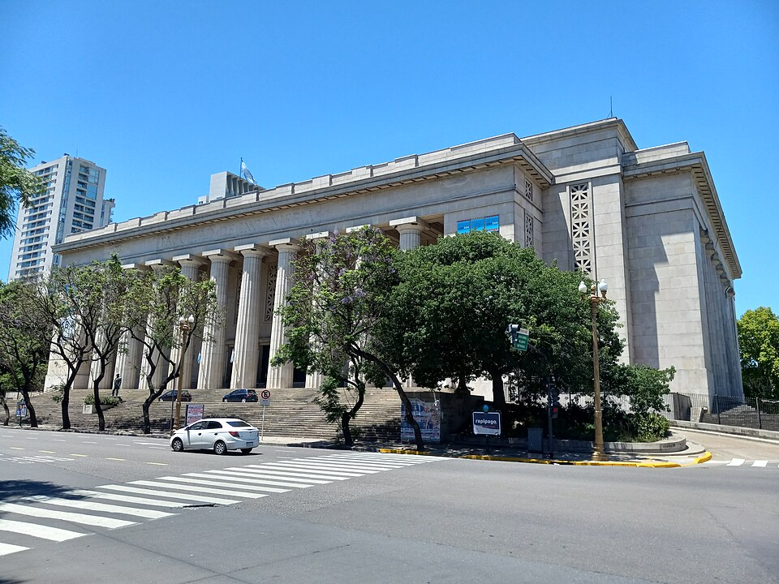

# Clase 3 - Problemas de optimización

  
  
  **Dr. Ing. Facundo Adrián Lucianna | CEIA - FIUBA**

> [!NOTE] 
> **Nota sobre este documento:** Este archivo sirve como resumen estructurado de los contenidos de la clase. Algunos recursos mencionados (como las evaluaciones, los foros y los videos de las clases grabadas) están alojados exclusivamente en el aula virtual y no se incluyen directamente en este repositorio. Dichos elementos están marcados con el símbolo 🔒.

## Materiales obligatorios

En esta nueva unidad, abordaremos los **problemas de optimización**, en los que no nos importa el camino hasta la solución, sino encontrar la mejor configuración posible según una función objetivo. Para resolverlos, veremos los **algoritmos de búsqueda local**:

**Espacio discreto:**
1. Gradiente descendente o ascendente
2. Simulated annealing
3. Búsqueda local beam
4. Algoritmos genéticos

**Espacio continuo:**
1. Gradiente descendente o ascendente en espacio continuo

- 📺 Clase 3.1 - Problemas de optimización (Video) 🔒 *(Solo en Campus Virtual)*

Como material de apoyo, encontrarán a continuación el **material teórico** y la **presentación en formato HTML** utilizados durante esta clase.

- 📘 [Teoría clase 3](./content/teoria/README.md)
- 🌐 [Versión presentación html](./content/teoria/clase3.html)

> [!NOTE]
> **Aclaración sobre la presentación:** Para visualizar correctamente la versión HTML animada, es necesario descargar el archivo *clase3.html* (junto con la carpeta *img*) a tu computadora y abrirlo con cualquier navegador web (Chrome, Firefox, Edge, etc.), ya que GitHub no previsualiza este tipo de formato.

### Ejemplo práctico: la gira de Los Auténticos Descendentes

En esta sección vamos a aplicar los algoritmos de búsqueda local a un problema clásico de optimización: el **problema del viajante**. **Los Auténticos Descendentes** presentan su nuevo disco, *«After Annealing»*, y salen de gira por el país en una avioneta clandestina. La gira arranca en Buenos Aires y termina en la Base Marambio, y queremos encontrar el orden de las ciudades que recorra la menor cantidad de kilómetros.

En la primera notebook modelamos el problema: cómo representar una gira, cómo medir su costo y cuáles son sus vecinos. Ver cómo una buena representación reduce el espacio de búsqueda es tan importante como el algoritmo que usemos después.

- 📓 [1 - Modelando la gira - Jupyter Notebook](./content/gira/1-modelando_la_gira.ipynb)

Con el problema modelado, buscamos la gira con **gradiente descendente**, y vemos cómo queda atrapado en mínimos locales.

- 📓 [2 - Gradiente descendente - Jupyter Notebook](./content/gira/2-gradiente_descendente.ipynb)

A continuación, usamos **Simulated Annealing**, que acepta empeorar de vez en cuando para escapar de esos mínimos.

- 📓 [3 - Simulated Annealing - Jupyter Notebook](./content/gira/3-simulated_annealing.ipynb)

Luego, buscamos con varias giras a la vez usando **Local Beam**, y vemos por qué es tan importante mantener la diversidad.

- 📓 [4 - Local Beam - Jupyter Notebook](./content/gira/4-local_beam.ipynb)

Después, abordamos el problema con **algoritmos genéticos**, y vemos por qué los operadores tienen que respetar la estructura del problema.

- 📓 [5 - Algoritmos genéticos - Jupyter Notebook](./content/gira/5-algoritmo_genetico.ipynb)

Y, por último, comparamos todos los algoritmos lado a lado para sacar conclusiones.

- 📓 [6 - Comparando los algoritmos - Jupyter Notebook](./content/gira/6-comparando_algoritmos.ipynb)

El código que modela la gira (carga de ciudades, distancias, vecinos, mapas y carteles) está en el archivo `gira.py`, y los algoritmos de búsqueda, en `search_methods.py`. Las fuentes de los datos están detalladas en [DATOS.md](./content/gira/datos/DATOS.md).

De manera opcional, pueden ver cómo se adaptan gradiente descendente y Simulated Annealing a un **espacio continuo**, buscando los mínimos de las funciones de Himmelblau y Rastrigin:

- 📓 [Búsqueda en espacios continuos - Jupyter Notebook](./content/extras/busqueda_continua.ipynb)

### Evaluación práctica

  

  Foto: <a href="https://commons.wikimedia.org/wiki/File:Facultad_de_Ingenier%C3%ADa_Universidad_de_Buenos_Aires_(FIUBA).jpg">Facultad de Ingeniería Universidad de Buenos Aires (FIUBA)</a>, de Gobonobo, bajo licencia <a href="https://creativecommons.org/licenses/by-sa/3.0/">CC BY-SA 3.0</a>.

Ahora que ya tienen las herramientas necesarias, es momento de realizar la **evaluación práctica**: aproximar una foto de la Facultad de Ingeniería usando solamente 100 triángulos, implementando **Simulated Annealing**. Asegúrense de leer detenidamente el enunciado y no duden en plantear cualquier inquietud en el **foro**.

- 📝 Evaluación práctica - Módulo 3 🔒 *(Solo en Campus Virtual)*
- 📝 [Enunciado de la evaluación práctica](./exercise/README.md)

Recuerden que el código que les puede servir para realizar la evaluación está en el repositorio.

- 📓 [Link al notebook de la evaluación práctica - Jupyter Notebook](./exercise/aproximando_la_fiuba.ipynb)

## Dudas y consultas

Cualquier duda técnica o conceptual referida a esta unidad puede volcarse libremente en la sección de participación general del **foro**. 

- 💬 Foro de consulta - Módulo 3 🔒 *(Solo en Campus Virtual)*

## Actividades no obligatorias

Si desean seguir profundizando en estos temas, les recomiendo explorar [Google OR-Tools](https://developers.google.com/optimization), una librería de código abierto para resolver problemas de optimización, entre ellos el problema del viajante.
