# Clase 3: Problemas de Optimización

<div align="center">
  
  
  **Dr. Ing. Facundo Adrián Lucianna | CEIA - FIUBA**
</div>

---

## 🏔️ Algoritmos de búsqueda local

### ¿Y si no nos importa el camino?

<div align="center">
  
</div>

Los algoritmos de búsqueda que vimos la clase anterior se diseñan para explorar **sistemáticamente** espacios de búsqueda. Esta forma sistemática se alcanza manteniendo uno o más caminos en memoria y registrando qué alternativas se han explorado en cada punto a lo largo del camino y cuáles no.

Cuando se encuentra un objetivo, **el camino** a ese objetivo también constituye una **solución** al problema.

Pero hay problemas en donde **no** nos importa el camino, sino que importa la configuración final. Por ejemplo, encontrar el recorrido más corto que pase por un conjunto de ciudades.

---

### Búsqueda local

Si no importa el camino al objetivo, podemos considerar una clase diferente de algoritmos que no se preocupen en absoluto de los caminos.

Los algoritmos de búsqueda local funcionan con un solo **estado actual** y generalmente se mueven solo a los **vecinos** del estado. Estos algoritmos tienen dos ventajas:

1. Usan poca memoria.
2. Pueden encontrar soluciones razonables en espacios de estados grandes o infinitos (continuos).

---

### Problemas de optimización

Los algoritmos de búsqueda local son útiles para resolver **problemas de optimización** puros, en los cuales el objetivo es encontrar el mejor estado según una **función objetivo**.

Un problema de optimización consiste en minimizar o maximizar el valor de una variable. En otras palabras, se trata de calcular o determinar el valor mínimo o el valor máximo de una función.

Los problemas de optimización se pueden dividir en dos categorías:

- Un problema con variables discretas se conoce como **optimización discreta**, en la que un objeto como un número entero, una permutación o un grafo se debe encontrar en un conjunto contable.
- Un problema con variables continuas se conoce como **optimización continua**, en la que se debe encontrar un valor óptimo de una función continua.

<div align="center">
  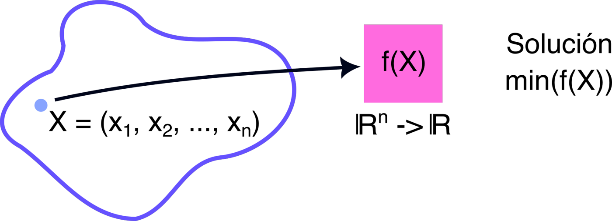
</div>

<div align="center">
  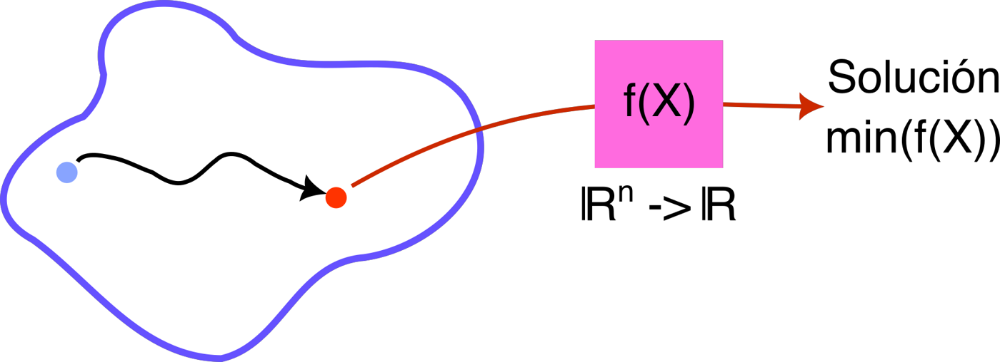
</div>

Pasemos a un caso de una sola variable, así podemos observar:

<div align="center">
  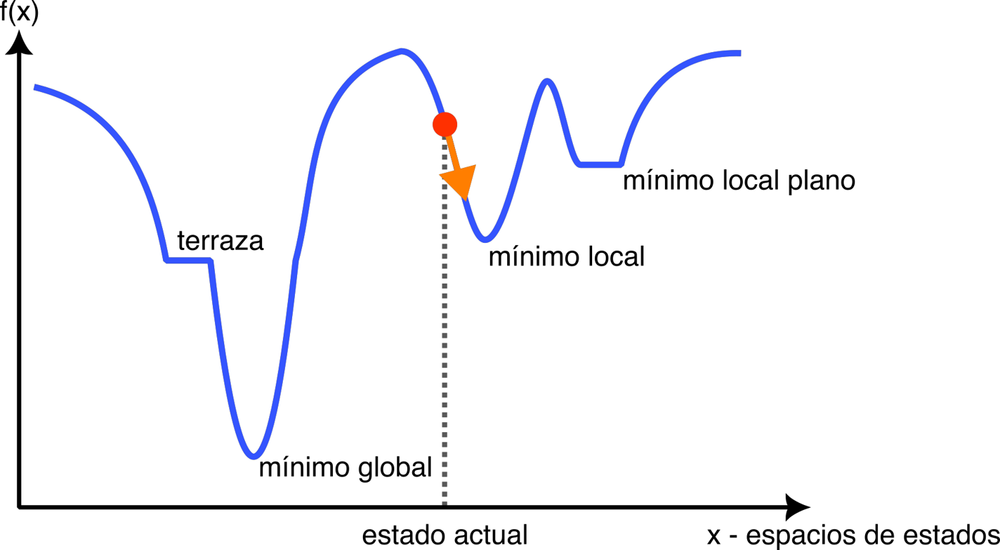
</div>

Hay múltiples algoritmos de búsqueda local. Los que veremos son:

- **Espacio discreto**:
  - Gradiente descendente o ascendente
  - Simulated annealing
  - Búsqueda local beam
  - Algoritmos genéticos
- **Espacio continuo**:
  - Gradiente descendente o ascendente en espacio continuo

---

## ⛰️ Gradiente descendente o ascendente

### Gradiente descendente o ascendente discreto

Este algoritmo se mueve continuamente en la dirección en la que el valor de la función más decrece (o crece). Termina la búsqueda cuando ningún vecino está más bajo. El algoritmo no mira más allá de sus vecinos.

<div align="center">
  
</div>

---

### Búsqueda local voraz

A esta búsqueda se le llama búsqueda local voraz (*greedy*), porque avanza a un estado vecino sin pensar a dónde ir después.

Avanza muy rápido hacia una solución, pero es fácil llegar a un estado no ideal. Se atasca por los siguientes motivos:

- **Mínimo (máximo) local**: un mínimo local es un valle que es más bajo que sus estados vecinos, pero está más arriba que el mínimo global.
- **Meseta**: una meseta es un área donde la función de evaluación es plana.
- **Crestas**: las crestas causan una secuencia de mínimos locales que hace muy difícil la navegación.

<div align="center">
  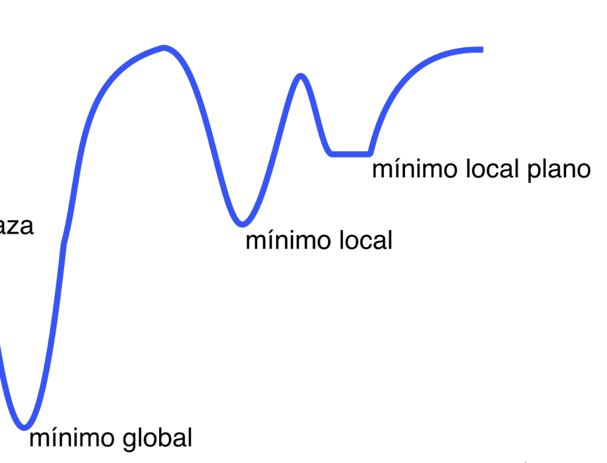
  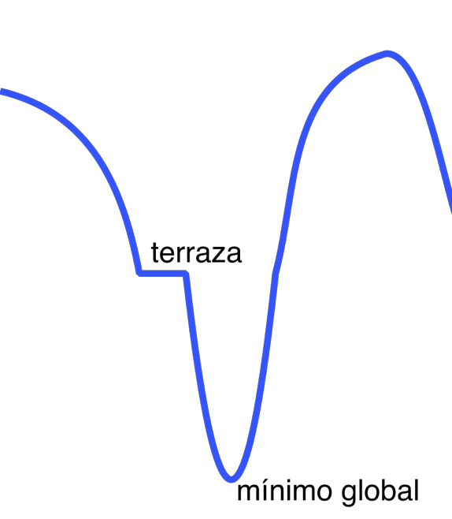
  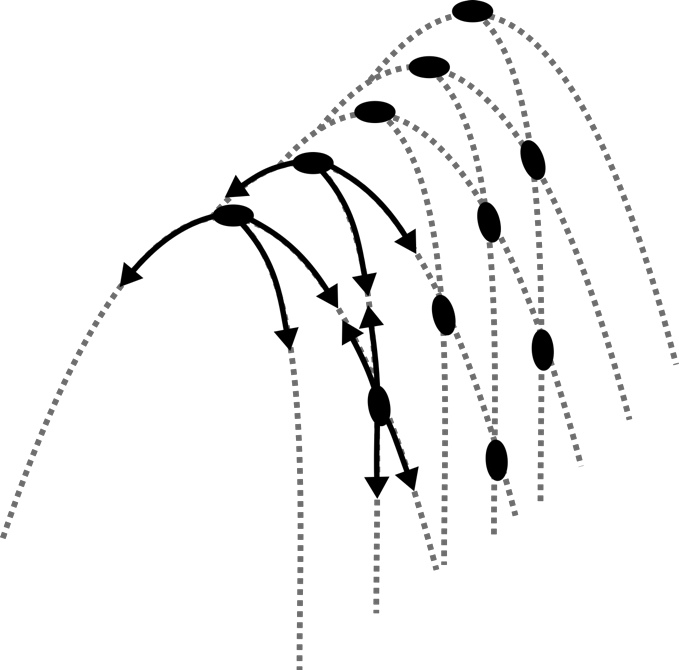
</div>

---

### Variantes

- **Ascenso o descenso estocástico**: se escoge aleatoriamente la dirección entre los movimientos ascendentes (o descendentes) posibles. Converge más lento, pero en ciertos casos encuentra una mejor solución.
- **Ascenso o descenso estocástico de primera opción**: genera sucesores al azar hasta que genera uno que es mejor que el estado actual.
- **Ascenso o descenso de reinicio aleatorio**: realiza una serie de búsquedas desde estados iniciales generados aleatoriamente, y se detiene cuando encuentra un objetivo.

---

## 🔥 Simulated annealing

### Temperatura

<div align="center">
  
</div>

Para escapar de los mínimos locales, el algoritmo da una sacudida al azar. Para lograrlo usa un nuevo parámetro que llamamos **temperatura**.

Cuanto mayor es la temperatura, más probable es que podamos movernos en dirección contraria. Cuando baja la temperatura, baja esta probabilidad. Si la temperatura es cero, estamos ante un algoritmo de gradiente descendente puro.

Este algoritmo arranca con mucha temperatura y, a medida que avanza, se va enfriando, de igual forma que el metal.

Se puede demostrar que, si se disminuye la temperatura lo bastante despacio, el algoritmo encontrará un óptimo global con probabilidad cercana a uno.

---

### Distribución de Boltzmann

<div align="center">
  
</div>

Para determinar si se hace el cambio, se usa la **distribución de Boltzmann**, que es la distribución de probabilidad de las partículas de un sistema entre sus estados posibles:

$$F \propto e^{-\Delta E / kT}$$

Esta distribución establece que, cuanto más grande es la diferencia de energía (o, en nuestro caso, la diferencia de la función de costo), menos probable es que se elija el cambio. Pero si la **temperatura es alta, esta probabilidad es mayor** y es más fácil que de todas formas se elija.

---

## 🔦 Búsqueda local beam

### k estados a la vez

Buscar desde un único estado inicial es una medida un poco extrema de ahorro de memoria. En cambio, la **búsqueda local beam** guarda la información de **k estados**, que se inician al azar.

En cada paso se generan los sucesores de los k estados. Si alguno cumple el objetivo, se termina. Si no, se seleccionan los k mejores sucesores de la lista.

A simple vista parecería lo mismo que ejecutar k veces gradiente descendente o ascendente, pero la diferencia es que entre los procesos de búsqueda hay pase de información:

> Si un estado genera varios sucesores buenos y los otros k−1 estados generan sucesores malos, el algoritmo abandona la búsqueda de los otros y se queda con los sucesores del primer estado.

El algoritmo abandona rápidamente las búsquedas infructuosas y mueve sus recursos a donde se hace la mayor parte del progreso.

---

### Diversidad

El principal **inconveniente** de este algoritmo es que puede sufrir carencia de diversidad de estados, y enfocarse en una sola parte muy limitada del espacio.

Una variante es la **búsqueda de haz estocástica**, en la que, en vez de elegir los k mejores sucesores, se eligen aleatoriamente, con una función de temperatura similar a la de *simulated annealing*.

Esta búsqueda muestra un parecido con el proceso de selección natural: los *sucesores* (descendientes) de un *estado* (organismo) pueblan la siguiente generación según su *valor* (idoneidad o salud).

---

## 🧬 Algoritmos genéticos

### Población

<div align="center">
  
</div>

Un **algoritmo genético** es una variante de la búsqueda local beam estocástica en la que los estados sucesores se generan combinando dos estados padres (reproducción), en lugar de modificar un solo estado (reproducción asexual).

La analogía con la selección natural es la misma que antes.

Los algoritmos genéticos comienzan con un conjunto de k estados aleatorios, llamado **población**. Cada estado, o **individuo**, está representado como una cadena de caracteres sobre un **alfabeto finito**, que representa el código genético del estado.

---

### Una generación

<div align="center">
  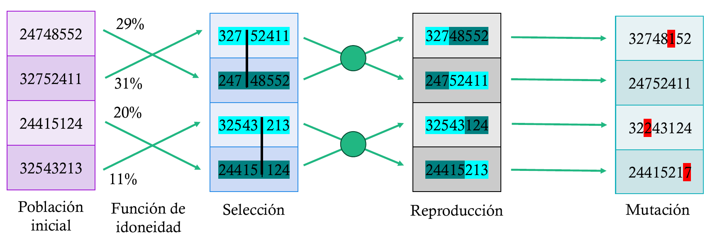
</div>

---

### ¿Por qué funciona?

Como en la búsqueda local beam estocástica, los algoritmos genéticos combinan una tendencia ascendente con exploración aleatoria, e intercambian información entre los hilos paralelos de búsqueda.

La ventaja del algoritmo genético viene de la operación de **reproducción**, que combina bloques grandes de letras que evolucionaron de forma independiente para realizar funciones útiles. Así se aumenta el nivel de granularidad en el que funciona la búsqueda.

```python
def gen_alg(poblation, fun_ido):
    new_poblation = []

    while 1:
        for i in range(len(poblation)):
            x = sel_aleatory(poblation, fun_ido)
            y = sel_aleatory(poblation, fun_ido)
            child = reproduction(x, y)
            dice = random()
            if dice < 0.01:
                child = mutate(child)
            new_poblation.append(child)
        poblation = new_poblation

        for z in poblation:
            if z is solution:
                return z

def reproduction(x, y):
    n = len(x)
    c = random_int(0, n)
    return x[:c] + y[c:]
```

---

## 🌐 Búsqueda en espacios continuos

### Infinitos sucesores

<div align="center">
  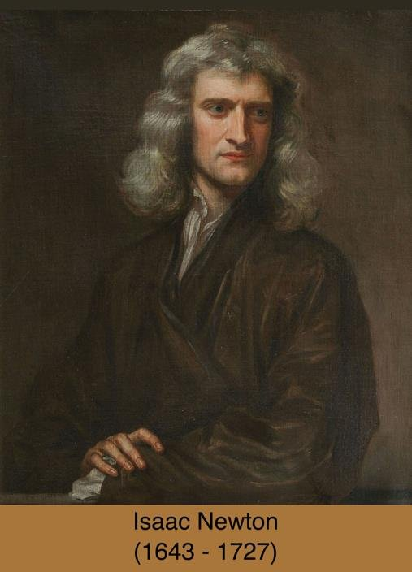
  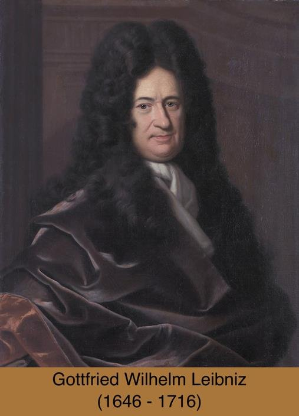
</div>

Los algoritmos que vimos hasta ahora no se pueden aplicar directamente en espacios continuos, ya que los sucesores de cada estado son infinitos.

La literatura sobre búsqueda en espacios continuos es enorme y es tan vieja como la época de Newton y Leibniz (siglo XVII).

---

### Un ejemplo: dos aeropuertos

Supongamos que queremos ubicar dos aeropuertos nuevos en Argentina, de tal forma que la suma de las distancias al cuadrado entre cada gran ciudad (Buenos Aires, La Plata, Córdoba y Rosario) y su aeropuerto más cercano sea mínima.

Entonces el espacio de estados está definido por 4 coordenadas: (x<sub>1</sub>, y<sub>1</sub>) y (x<sub>2</sub>, y<sub>2</sub>), que corresponden a la ubicación de los aeropuertos. Es un espacio de cuatro dimensiones: los estados están definidos por 4 variables.

Moverse en este espacio corresponde a mover los aeropuertos.

La función objetivo f(x<sub>1</sub>, y<sub>1</sub>, x<sub>2</sub>, y<sub>2</sub>) es relativamente fácil de calcular, sumando las distancias de cada ciudad a su aeropuerto.

<div align="center">
  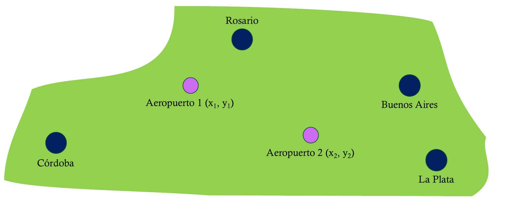
</div>

---

### Discretizar el espacio

Una forma de resolver esto es **discretizar el espacio**.

Por ejemplo, podemos mover los aeropuertos de a pequeños pasos de tamaño fijo, en dirección x o y. Con 4 variables, esto nos da 8 sucesores para cada estado, y desde ahí aplicamos cualquier algoritmo de búsqueda local.

<div align="center">
  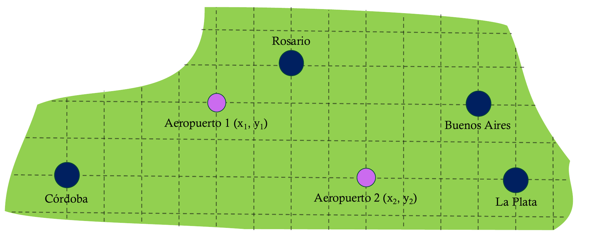
</div>

---

### El gradiente

<div align="center">
  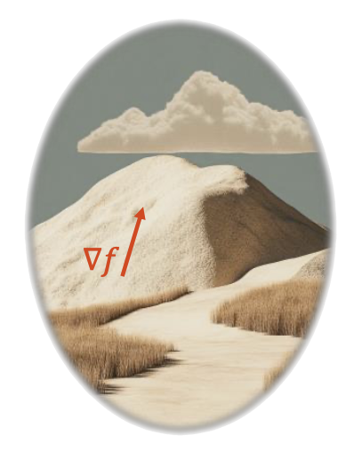
</div>

También podemos usar el **gradiente** para encontrar un máximo o un mínimo:

$$\nabla f = \left( \frac{\partial f}{\partial x_1}, \frac{\partial f}{\partial y_1}, \frac{\partial f}{\partial x_2}, \frac{\partial f}{\partial y_2} \right)$$

En algunos casos podemos resolver la ecuación:

$$\nabla f = 0$$

En el ejemplo, si tuviéramos un solo aeropuerto, la solución sería la media aritmética de la ubicación de las ciudades.

---

### Gradiente descendente en espacios continuos

<div align="center">
  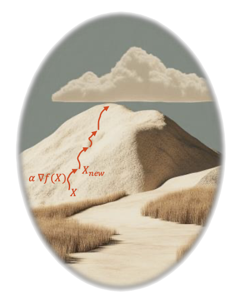
</div>

En muchos casos esa ecuación no puede resolverse directamente. Pero podemos usar el algoritmo de gradiente, haciendo un cambio local:

$$X_{new} = X - \alpha \nabla f(X)$$

Donde α es una constante pequeña, que en redes neuronales se llama **tasa de aprendizaje**.

Hay casos en los que la función objetivo no es diferenciable. En esos casos se usa el **gradiente empírico**, evaluando pequeños incrementos y decrementos de cada coordenada.

---

### La tasa de aprendizaje

La elección de α es sumamente importante: si α es muy chica, necesitamos demasiados pasos, y si es muy grande, el algoritmo puede no converger nunca.

<div align="center">
  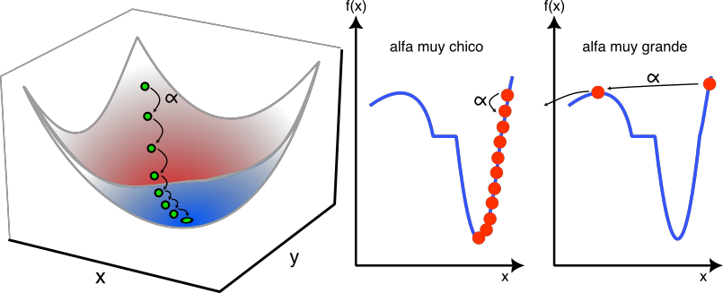
</div>
