# Clase 4: Aprendizaje Automático

  
  
  **Dr. Ing. Facundo Adrián Lucianna | CEIA - FIUBA**

---

## 🤖 Aprendizaje automático

### ¿Qué es el aprendizaje automático?

> *Una computadora observa algunos datos, construye un modelo basado en estos datos y usa el modelo como una hipótesis sobre el mundo y como una pieza de software que puede resolver problemas.*

¿Pero por qué queremos que una computadora aprenda?

- No se pueden anticipar todas las posibles situaciones futuras.
- No se tiene idea de cómo programar una solución por sí mismo.

  

---

### Ejemplo: detección de SPAM

  

Este problema se resuelve usando aprendizaje automático. Podemos ir analizando las palabras y los signos de puntuación de los correos.

Este es un problema que llamamos de **aprendizaje supervisado**, cuyo resultado es un indicador de si el correo es SPAM o no. Esto se llama **problema de clasificación**.

En este problema, no todo error al predecir es lo mismo. **Queremos evitar filtrar el buen correo electrónico**, mientras que dejar pasar el SPAM no es deseable, pero sus consecuencias son menos graves.

---

### Ejemplo: precio de venta de una casa

  

Se intenta predecir el precio de venta más apropiado de una casa dadas diferentes características, tales como el tamaño, la antigüedad y el lugar donde se encuentra.

Este es un problema de **aprendizaje supervisado**, conocido como **problema de regresión**, porque la medición del resultado es *cuantitativa*.

---

### Ejemplo: descubrimiento de segmentos de clientes

Una famosa cadena de electrodomésticos quiere entender cómo se segmentan sus clientes según su información demográfica y sus gustos, dados por su historial de compra.

Usando estos datos, se emplea un modelo que agrupa los datos en diferentes grupos por *similitud*.

Este tipo de problema es de **aprendizaje no supervisado** y, particularmente, de **agrupamiento** (*clustering*).

  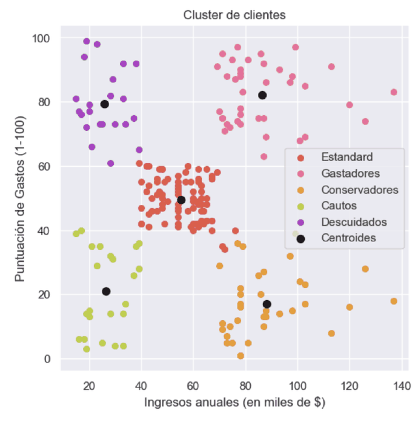

---

### Ejemplo: sistema de recomendación de videos

  

Una empresa dedicada a compartir videos necesita mantener a los usuarios comprometidos con la plataforma. Necesita que, cuando un video termine, se le recomiende al usuario el siguiente video a ver, de tal forma que la persona siga deseando quedarse en la plataforma.

Este tipo de algoritmos se llaman **sistemas de recomendación** y pueden englobarse en aprendizaje supervisado, aprendizaje no supervisado o aprendizaje por refuerzo.

---

## 📊 Datos

### Lo más importante

Lo más importante en aprendizaje automático son los...

  

---

### Entidades

Los datos nos permiten describir un objeto al que podemos llamar **entidad**.

Esta entidad y su información pueden ser diferentes a pesar de que describan un mismo objeto. *La forma en que se elija representar los datos no solo afecta la forma en que se construyen los sistemas, sino también los problemas que esos sistemas pueden resolver.*

Por ejemplo, queremos representar un auto:

  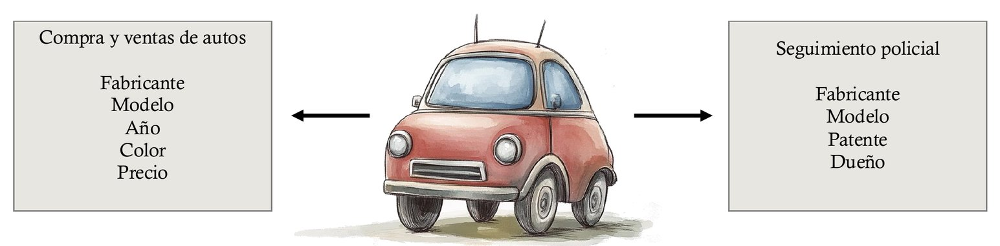

---

### Basura entra, basura sale

Si los datos con los que alimentamos un modelo son malos, el resultado también lo será:

  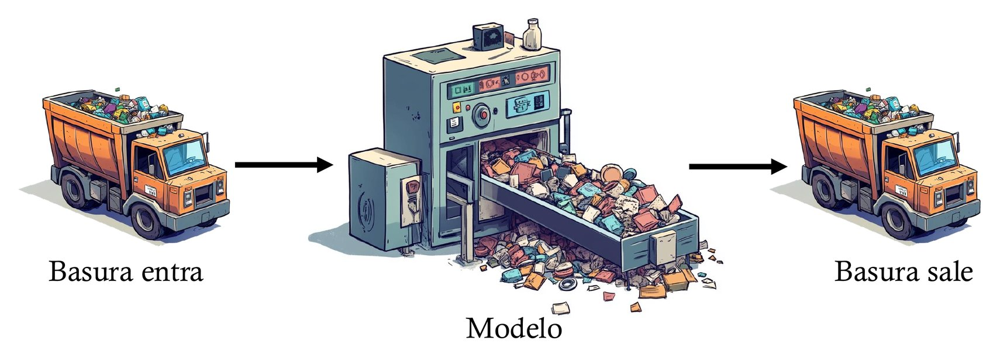

---

### Datos estructurados y no estructurados

Los datos se pueden encontrar en dos formas:

- **Datos estructurados**: tienen un formato estandarizado que permite tanto al software como a las personas acceder a ellos de forma eficaz. Se trata de **datos tabulares con filas y columnas que definen claramente sus atributos**. Las computadoras pueden procesar eficazmente los datos estructurados en busca de información, dado que se trata de información cuantitativa.
- **Datos no estructurados**: son información sin un *modelo de datos* establecido, o datos que no están ordenados de una manera predefinida. Por ejemplo, archivos de texto, videos, informes, correos electrónicos o imágenes.

---

### Datos estructurados

En aprendizaje automático, en general, se usan estructuras de dos dimensiones y notaciones vectoriales para referirnos a los datos:

- Cada fila es una **muestra**, **observación** o dato puntual.
- Cada columna es una **característica** (*feature* o **atributo**) de la observación.
- En el caso más general, hay una columna que llamaremos **objetivo**, **label**, **etiqueta** o **respuesta**, y que será el valor que se pretende predecir.

| Position | Experience | Skill | Country | City | **Salary ($)** |
| :--- | :---: | :---: | :--- | :--- | ---: |
| Developer | 0 | 1 | Argentina | Buenos Aires | 103100 |
| Data Scientist | 2 | 2 | Uruguay | Montevideo | 104900 |
| Developer | 3 | 1 | Argentina | Chivilcoy | 106800 |
| QA Eng | 2 | 2 | Colombia | Bogotá | 108700 |
| Product Manager | 1 | 5 | Perú | Lima | 110400 |
| Developer | 7 | 5 | Paraguay | Asunción | 112300 |
| Cloud Eng | 5 | 2 | Argentina | Buenos Aires | 116100 |

Las primeras cinco columnas son los **atributos** (*features*) y la última, el **objetivo**.

---

### Población y muestra

Cuando modelamos usando aprendizaje automático, tenemos una variable dependiente (**target**) $y$ (que podemos conocer o no), dado un conjunto de predictores $x_1, x_2, \ldots, x_p$, que podemos describir como un vector $X = (x_1, x_2, \ldots, x_p)$.

*El desafío en aprendizaje automático es elegir las entradas correctas.*

El conjunto total de estas observaciones se llama **población**, la cual casi nunca podemos tener; en cambio, tenemos un subconjunto de estas observaciones.

  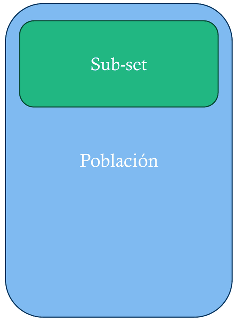

---

### Tipos de variables

Tenemos diferentes tipos de variables:

**Variables numéricas**: son aquellas que representan números y con las que se pueden realizar operaciones aritméticas. Pueden ser **discretas** (por ejemplo, la cantidad de perros) o **continuas** (por ejemplo, una altura).

  

**Variables categóricas**: son variables que pueden tomar uno de un número limitado y, por lo general, fijo de posibles valores. Pueden ser **nominales** (por ejemplo, el tipo de cerveza) u **ordinales**, cuando sus valores tienen un orden (por ejemplo, una calificación con estrellas).

  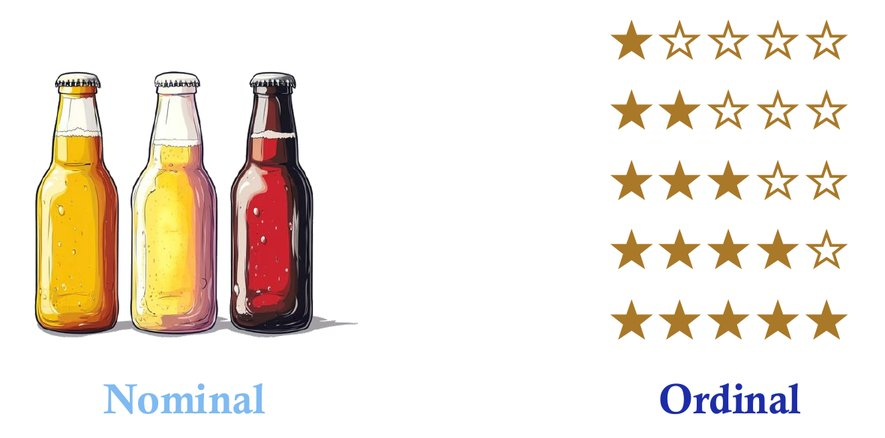

---

## 🧭 Formas de aprendizaje

### Un esquema del aprendizaje automático

Un esquema de cómo aplicar aprendizaje automático nos queda así: entrenamos un modelo $h(X)$ con un subconjunto de la población y luego lo usamos para predecir $y_{pred}$ sobre otros datos de la población.

  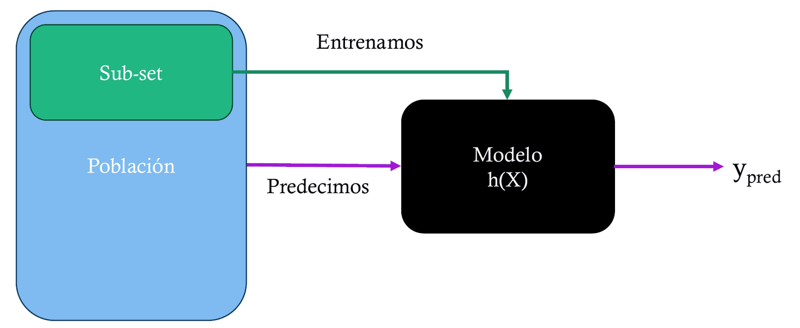

---

### Tipos de aprendizaje

Como vimos en los ejemplos, hay diferentes tipos de aprendizaje, que dependen principalmente de la forma que tiene $y$.

  

- **Aprendizaje supervisado**: el modelo observa pares de entradas y salidas y aprende la relación entre ellos. Es decir, en este tipo de aprendizaje conocemos el valor de $y$ y se lo enseñamos al modelo.
  - Los modelos aprenden de los resultados conocidos y realizan ajustes en sus parámetros internos para adaptarse a los datos de entrada.
  - Una vez que el modelo está entrenado adecuadamente, y sus parámetros internos son coherentes con los datos de entrada y los resultados de los datos de entrenamiento, el modelo podrá realizar predicciones adecuadas ante nuevos datos.
- **Aprendizaje no supervisado**: el modelo aprende patrones de la entrada sin ninguna retroalimentación. Es decir, no contamos con $y$ de antemano.
- **Aprendizaje por refuerzo**: el agente aprende con una serie de refuerzos: recompensas y castigos. Depende del agente decidir cuál de las acciones anteriores al refuerzo fue la más responsable de él, y modificar sus acciones para apuntar a más recompensas en el futuro.

---

## 🎓 Aprendizaje supervisado

### Definición

Más formalmente, podemos definir la tarea de aprendizaje supervisado como:

Dado un **set de entrenamiento** de $N$ observaciones de pares de entradas y salida:

$$(X_1, y_1), (X_2, y_2), \ldots, (X_N, y_N)$$

donde cada par está generado por una función desconocida $y = f(X)$, se utiliza una función $h$ que aproxima a la verdadera función $f$:

$$h(X) \approx f(X)$$

La función $h$ es la que llamamos la **hipótesis** de la población o el **modelo**, que proviene de un **espacio de hipótesis**.

Llamamos a las salidas $y$ ***ground truth***.

---

### Elegir el modelo

***¿Cómo elegimos el espacio de hipótesis?***

Es posible que tengamos algún conocimiento previo sobre el proceso que generó los datos, o podemos realizar un **análisis de datos exploratorio**: examinar los datos con pruebas estadísticas y visualizaciones para tener una idea de los datos y una noción de qué espacio de hipótesis podría ser apropiado. O simplemente podemos probar múltiples espacios de hipótesis y evaluar cuál funciona mejor.

***¿Y cómo elegimos un modelo dentro del espacio de hipótesis?***

Podríamos esperar una **hipótesis consistente**: una $h$ tal que cada $X_i$ en el conjunto de entrenamiento tenga $h(X_i) = y_i$. Si las salidas son de valor continuo, es muy difícil tener una salida exacta. En esos casos, se usa una **función de ajuste** para medir qué tan cerca está $h(X_i)$ de $y_i$.

---

### Riesgo empírico

En la realidad, no podemos saber exactamente qué tan bien funcionará un modelo predictivo en la práctica, porque no conocemos la verdadera distribución de los datos.

Siempre vamos a trabajar con subconjuntos: podemos estimar y optimizar el rendimiento del modelo en un conjunto conocido de datos de entrenamiento.

El rendimiento sobre este conjunto conocido de datos de entrenamiento se denomina **riesgo empírico**.

  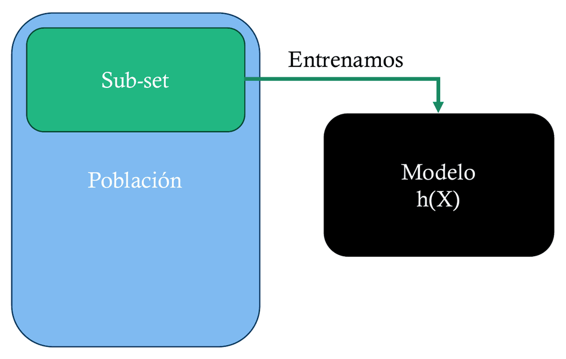

---

### Generalización

La verdadera medida de si un modelo funciona correctamente no es con respecto al conjunto de entrenamiento, sino qué tan bien maneja entradas que nunca vio.

Eso lo podemos ver con un segundo set de pares $(X_i, y_i)$ llamado **conjunto de prueba** (o de evaluación).

Se dice que $h$ **generaliza** bien si predice con precisión los resultados de este conjunto.

  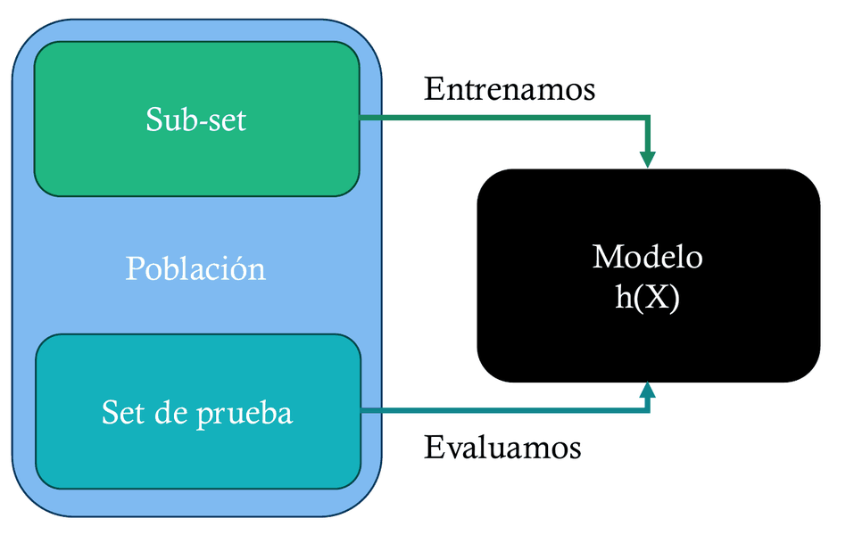

Todo esto nos deja el ciclo de vida de un modelo de aprendizaje automático:

  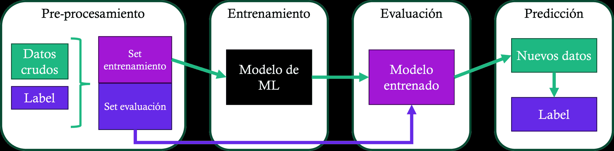

---

### Clasificación

Si el target $y$ es una *variable categórica* o toma valores discretos, este tipo de problema se llama **problema de clasificación**. A su vez, tenemos dos subvariantes:

- **Clasificación binaria** (por ejemplo, si es SPAM o no es SPAM).
- **Clasificación multiclase**: múltiples clases, como, por ejemplo, la clasificación del nivel socioeconómico de una persona (alto, medio o bajo).
  - Una variante de este tipo es cuando la cardinalidad es muy alta, es decir, cuando se tienen muchísimas clases.

  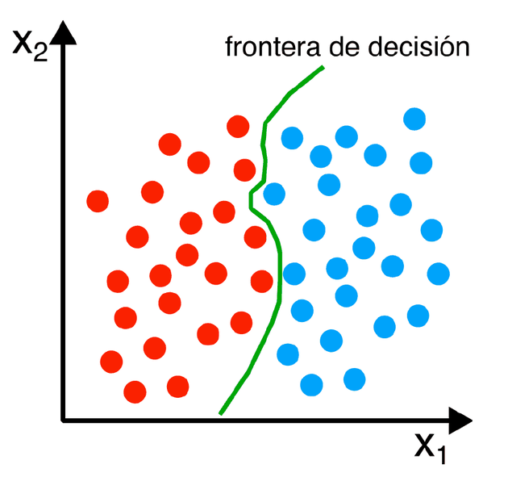

---

### Regresión

Si el target $y$ es una *variable numérica*, este tipo de problema se llama **problema de regresión**.

Se centra en estudiar las relaciones entre una variable dependiente y una o más variables independientes.

  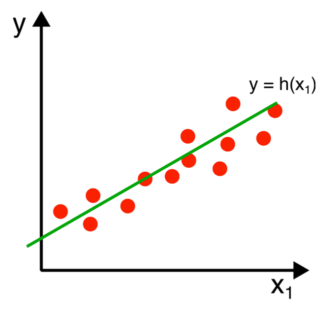

---

### Regresión vs. clasificación

Regresión y clasificación son problemas muy similares entre sí. En ambos buscamos predecir una variable; la diferencia radica en que la regresión predice una variable **numérica** y la clasificación, una **categórica**.

---

## ⚖️ Sesgo y varianza

### Tres modelos

Supongamos que tenemos tres modelos en un problema de regresión. Tenemos una sola entrada $x$ y una salida $y$ que depende de $x$ con una relación $f(x)$ que queremos modelar:

  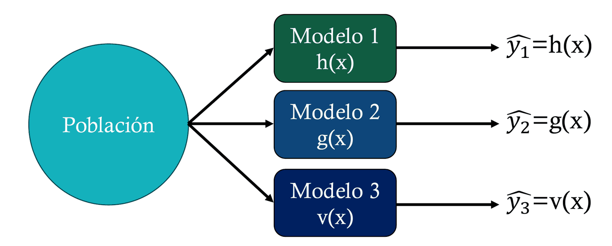

Entrenamos con un **set de entrenamiento** y nos queda:

  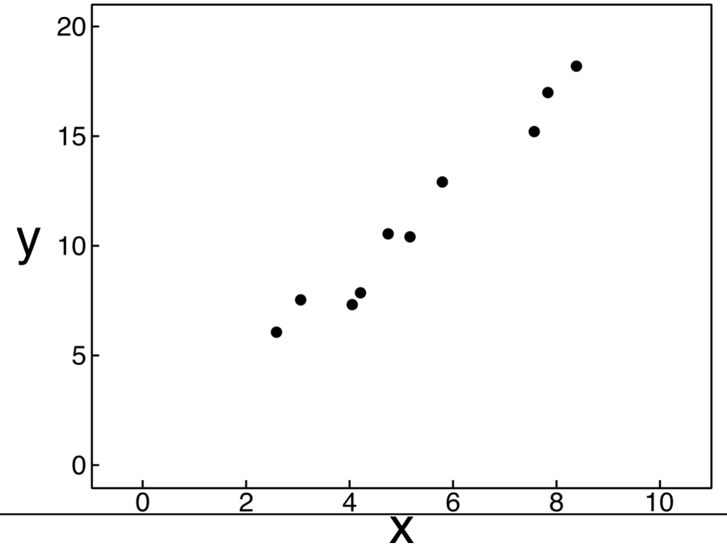
  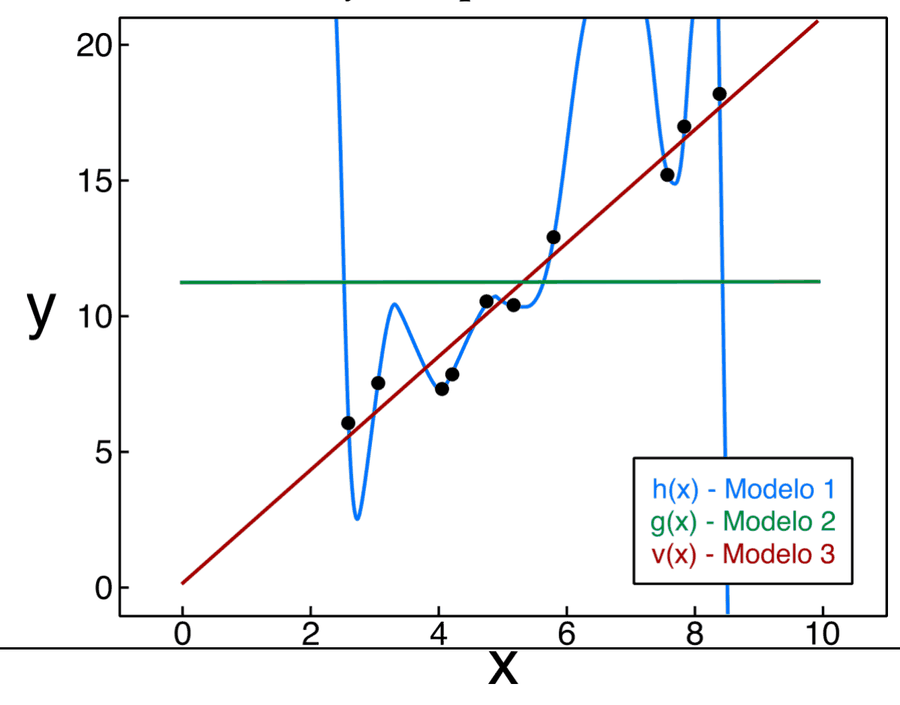

---

### Midamos el error

Para medir el error, calculamos el **error absoluto medio** (MAE):

$$MAE_p = \frac{1}{N} \sum_{i=1}^{N} |y_i - \hat{y}_{p,i}|$$

- Modelo 1: $MAE_1 = 0$
- Modelo 2: $MAE_2 = 5$
- Modelo 3: $MAE_3 = 1.25$

Según el set de entrenamiento, el modelo 1 es el mejor. ¿Pero realmente es el mejor? Evaluemos con el **set de evaluación** (en rojo):

  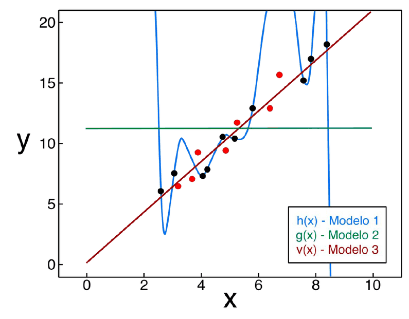

- Modelo 1: $MAE_1 = 90$
- Modelo 2: $MAE_2 = 5.2$
- Modelo 3: $MAE_3 = 1.75$

---

### Sobreajuste y subajuste

El modelo 1 rinde muy bien con los datos de entrenamiento, pero muy mal con los de evaluación. Esto es lo que se llama **sobreajuste**: el modelo aprende tan bien que incluso aprende el ruido de los datos. Este modelo tiene demasiados parámetros, por lo que es demasiado complejo y, por consiguiente, **no generaliza**.

Cuando se elige un modelo, se busca que:

$$\text{parámetros} \ll \text{cantidad de observaciones de entrenamiento}$$

El modelo 2 rinde pobremente tanto con el conjunto de entrenamiento como con el de evaluación. Este modelo no logra capturar el comportamiento buscado. Cuando esto ocurre, hablamos de **subajuste**.

El modelo 3 es el mejor modelo: el resultado en el conjunto de evaluación y en el de entrenamiento es similar, y el modelo **generaliza** sin aprender el ruido.

---

### Error de sesgo y error de varianza

El error que se comete con un modelo que sobreajusta y con uno que subajusta es diferente:

- El error de **sobreajuste** lo llamamos **error de varianza**.
- El error de **subajuste** lo llamamos **error de sesgo**.

Todo modelo tiene un error total, que está compuesto por ambos errores.

Estos errores son complementarios entre sí: si queremos reducir uno, el otro va a aumentar.

---

### Diferentes sets de entrenamiento

Estos errores los podemos ver si tomamos diferentes **sets de entrenamiento** y entrenamos el modelo con cada uno de ellos.

  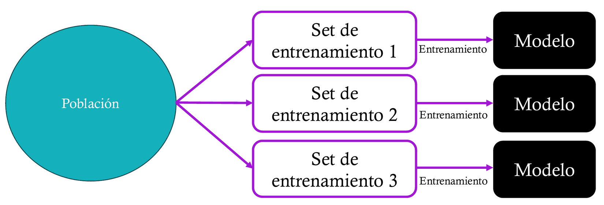

Si tenemos un modelo que **sobreajusta**, diferentes sets de entrenamiento nos darán modelos muy diferentes:

  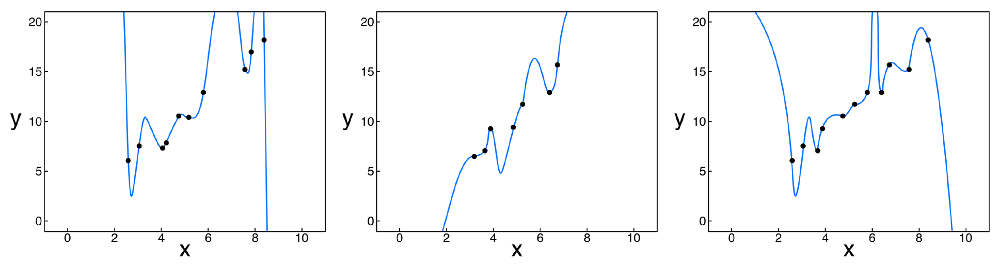

Si tenemos un modelo que **subajusta**, diferentes sets de entrenamiento nos darán modelos muy similares:

  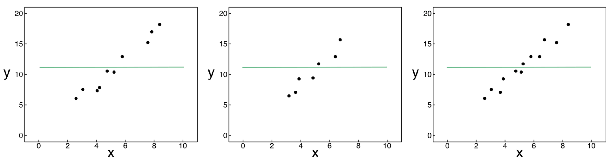

---

### Comparando los modelos

El modelo más simple cometerá muchos errores en prácticamente cualquier conjunto de entrenamiento, lo que significa que tiene **un error alto de sesgo**. Sin embargo, cuando evaluamos estos modelos con el conjunto de evaluación, el resultado siempre es similar. Entonces, decimos que tiene un **error de varianza bajo**.

Por otro lado, el modelo complejo se adapta perfectamente a cada conjunto de entrenamiento. Tiene **un error de sesgo muy bajo**, pero un **error de varianza muy alto** (ya que dos conjuntos de entrenamiento cualesquiera probablemente darían lugar a modelos muy diferentes).

Si analizamos cada caso, observamos que el modelo lineal tiene un error pequeño, ya que tiene poca varianza y poco sesgo:

  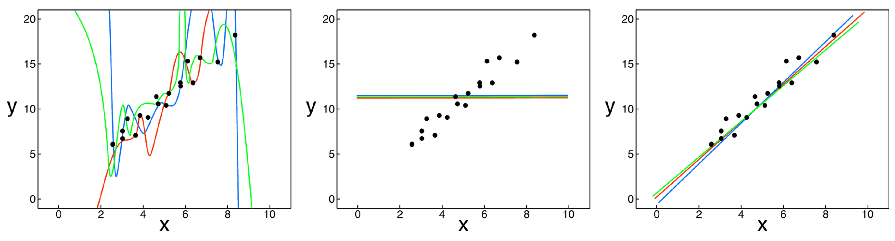

---

### El balance entre sesgo y varianza

Como regla general:

- Cuanto más complejo es el modelo, la varianza aumentará y el sesgo disminuirá.
- Cuando aumentamos la complejidad del modelo, el sesgo tiende a disminuir más rápido de lo que la varianza aumenta, y el error se reduce.
- Llega un punto en el que el efecto de la varianza es apreciable, y el error vuelve a aumentar.

  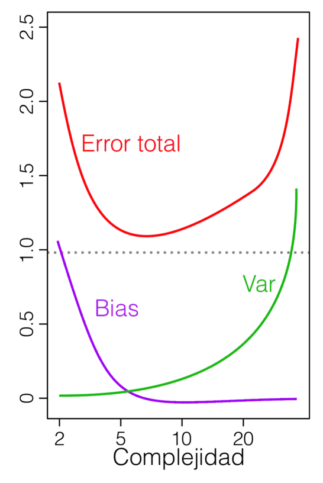

---

## 🛠️ Estrategias para disminuir el riesgo empírico

### Parámetros e hiperparámetros

Pensemos ahora en los modelos como cajas grises: todavía no sabemos cómo funcionan, pero tenemos una idea de que tienen parámetros, los cuales son de dos tipos:

- **Parámetros que se entrenan**: son los parámetros que un modelo aprende cuando lo entrenamos. Ya vimos que su número debe ser mucho menor que la cantidad de datos de entrenamiento para evitar el sobreajuste.
- **Hiperparámetros**: son parámetros *internos* que no dependen de los datos. Estos deben ser definidos antes de entrenar.

---

### Elegir los hiperparámetros

  

Elegir estos hiperparámetros es un desafío importante: para tener el mejor modelo deberíamos conocerlos de antemano, pero para conocerlos, debemos entrenar.

Entonces, lo que se hace es entrenar muchos modelos con diferentes hiperparámetros, y ver cuál es el mejor.

¡Pero si usamos el **set de evaluación** para elegirlos, encontraremos el mejor modelo para ese set, con el riesgo de que **no generalice**!

---

### Set de validación

Entonces, debemos usar un tercer conjunto de datos, que sacamos del de entrenamiento, llamado **set de validación**. Este conjunto nos permite:

- Evaluar diferentes valores de hiperparámetros.
- Ver si el modelo está sobreajustando, o evaluar el modelo mientras aprende.

*En Deep Learning es normal usarlo para evaluar durante el entrenamiento. Este entrenamiento se hace con gradiente descendente, y es importante ver, cada cierta cantidad de iteraciones, cómo evoluciona.*

Con este conjunto evitamos usar el de evaluación y *"hacer trampa"*.

Esto mejora la generalización, pero es muy sensible a la selección del conjunto de validación. Además, quitamos datos que nos podrían haber servido para entrenar. Una estrategia que nos evita esto es usar **validación cruzada**.

---

### Validación cruzada

La más conocida es la **validación cruzada K-Fold**. Dividimos el set de entrenamiento en $K$ partes (en el ejemplo, $K = 3$). En cada vuelta, entrenamos con $K - 1$ partes (en rojo) y evaluamos con la parte restante (en verde):

  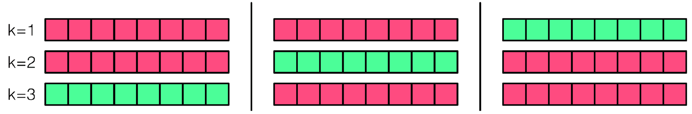

  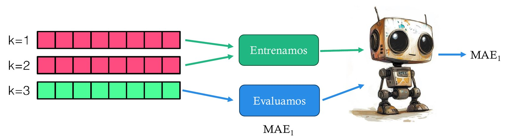
  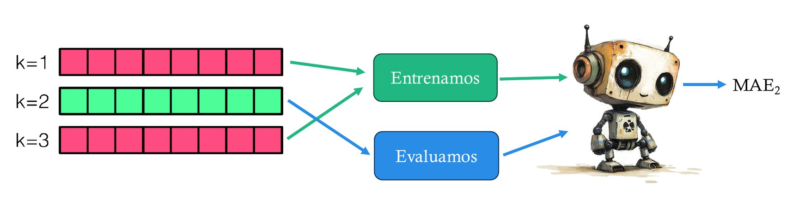
  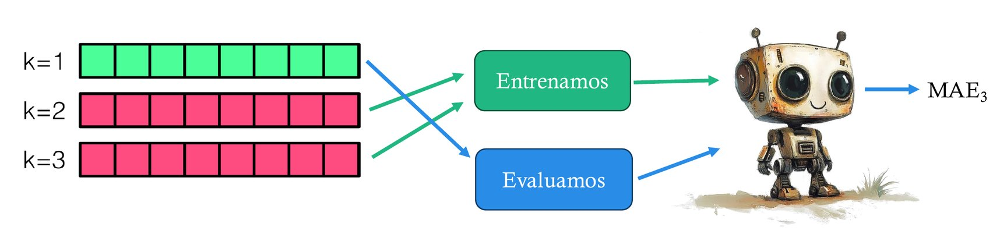

Con las $K$ métricas obtenidas, calculamos su promedio $\overline{MAE}$:

  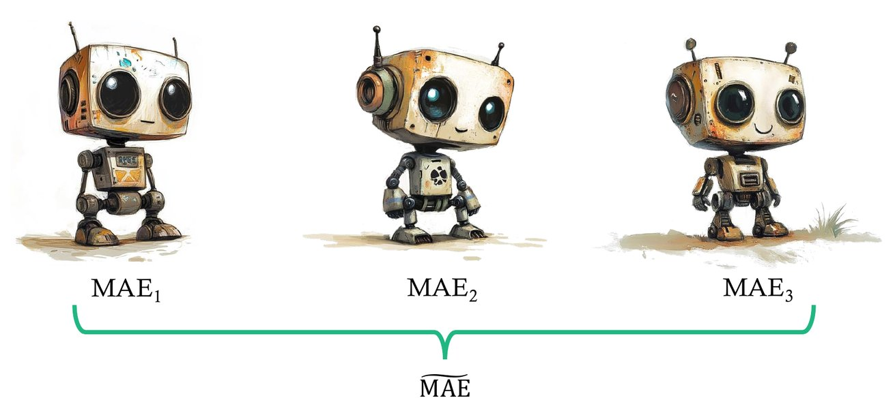

Si repetimos este proceso con otro modelo, o con otros hiperparámetros, podemos comparar sus promedios y quedarnos con el de menor error:

  

---

### Ventajas y desventajas de la validación cruzada K-Fold

**Beneficios**:

- Es una estrategia sistemática para encontrar los hiperparámetros.
- Nos permite evaluar al menos una vez cada punto de entrenamiento.
- Nos permite evaluar problemas de sobreajuste.
- No toca el conjunto de evaluación.

**Desventaja**:

- Es un proceso muy lento: cada modelo debe entrenarse $K$ veces.

*En procesos lentos y con conjuntos de entrenamiento muy grandes, conviene usar un conjunto de validación.*

---

### Regularización

Otra estrategia es la **regularización**, que penaliza la complejidad del modelo para reducir el error de varianza. Si regularizamos demasiado, el modelo se vuelve demasiado simple y aparece un error de sesgo alto:

  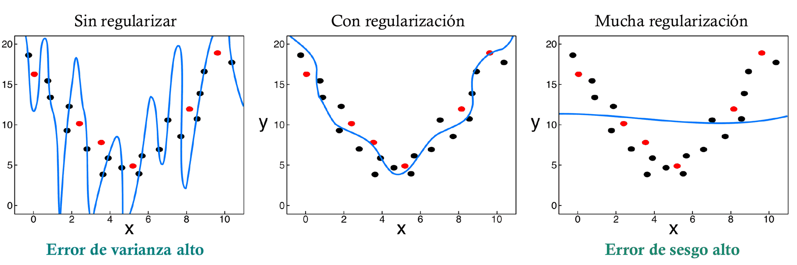

Veremos cómo se aplica la regularización en la próxima clase, con la regresión Ridge y Lasso.
