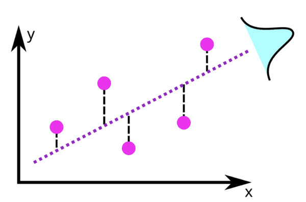

# Obtención de ecuaciones normales mediante máxima verosimilitud

  
  
  **Dr. Ing. Facundo Adrián Lucianna | CEIA - FIUBA**

---

En la teoría vimos cómo obtener las **ecuaciones normales** minimizando la suma de los residuos al cuadrado. En este apunte vamos a ver que también se pueden obtener mediante la **maximización de la verosimilitud**, y que ambos caminos llevan al mismo resultado.

## 📏 El modelo y sus suposiciones

La recta de regresión es, en realidad, un modelo aproximado de la relación entre $X$ e $y$. Para cada observación, se tiene:

$$y_{[i]} = b + \mathbf{W}^T \mathbf{X}_{[i]} + e_{[i]}$$

donde $e_{[i]}$ representa el **residuo**, dado por la distancia entre el valor observado y el valor predicho por la recta.

Además, suponemos que:

- **Relación lineal**: la relación entre $X$ e $y$ es lineal.
- **Características independientes**: las características de entrada de la regresión deben ser independientes entre sí.
- **Residuos**: deben provenir de una distribución normal $N(0, \sigma^2)$ y ser independientes entre sí.

Podemos asumir que el valor de $e$ es un valor aleatorio, consecuencia de múltiples pequeñas causas independientes que se suman y contribuyen a apartar el punto de la recta. Por el **Teorema Central del Límite**, es razonable modelar el residuo como:

$$e \sim N(0, \sigma^2)$$

Es decir, los valores de $y$ se distribuyen alrededor de la recta, centrados en ella, y con varianza constante $\sigma^2$:

  

---

## 🎲 La verosimilitud

Dado que el residuo tiene una distribución normal, la verosimilitud de observar un valor particular $y_{[i]}$ dado un valor específico $\mathbf{X}_{[i]}$ se puede expresar utilizando la función de densidad de la distribución normal:

$$f_{b,\mathbf{W}}\left(y_{[i]} \mid \mathbf{X} = \mathbf{X}_{[i]}\right) = \frac{1}{\sigma\sqrt{2\pi}} \exp\left(-\frac{1}{2\sigma^2} \left(y_{[i]} - b - \mathbf{W}^T \mathbf{X}_{[i]}\right)^2\right)$$

Podemos encontrar los parámetros $\mathbf{W}$ y $b$ utilizando el **principio de máxima verosimilitud**, es decir, buscando aquellos valores que maximicen la verosimilitud sobre todo el conjunto de datos:

$$L(b, \mathbf{W}) = \prod_{i=0}^{N-1} f_{b,\mathbf{W}}\left(y_{[i]} \mid \mathbf{X} = \mathbf{X}_{[i]}\right)$$

Podemos escribir la verosimilitud como un producto porque todos los pares $(\mathbf{X}_{[i]}, y_{[i]})$ se asumen **independientes e idénticamente distribuidos** (como mencionamos en las suposiciones). Reemplazando la densidad:

$$L(b, \mathbf{W}) = \prod_{i=0}^{N-1} \left[\frac{1}{\sigma\sqrt{2\pi}} \exp\left(-\frac{1}{2\sigma^2} \left(y_{[i]} - b - \mathbf{W}^T \mathbf{X}_{[i]}\right)^2\right)\right]$$

$$L(b, \mathbf{W}) = \left(\frac{1}{\sigma\sqrt{2\pi}}\right)^N \prod_{i=0}^{N-1} \exp\left(-\frac{1}{2\sigma^2} \left(y_{[i]} - b - \mathbf{W}^T \mathbf{X}_{[i]}\right)^2\right)$$

Y como el producto de exponenciales es la exponencial de la suma:

$$L(b, \mathbf{W}) = \left(\frac{1}{\sigma\sqrt{2\pi}}\right)^N \exp\left(-\frac{1}{2\sigma^2} \sum_{i=0}^{N-1} \left(y_{[i]} - b - \mathbf{W}^T \mathbf{X}_{[i]}\right)^2\right)$$

Los coeficientes obtenidos mediante este principio se llaman **estimadores de máxima verosimilitud**.

---

## 🪵 La log-verosimilitud

Maximizar una función de productos es complicado, especialmente si involucra exponenciales. Para simplificar, aplicamos el logaritmo a la verosimilitud. Como el logaritmo es una función creciente, el máximo se encuentra en el mismo lugar:

$$\ln\left(L(b, \mathbf{W})\right) = \ln\left(\left(\frac{1}{\sigma\sqrt{2\pi}}\right)^N \exp\left(-\frac{1}{2\sigma^2} \sum_{i=0}^{N-1} \left(y_{[i]} - b - \mathbf{W}^T \mathbf{X}_{[i]}\right)^2\right)\right)$$

$$\ln\left(L(b, \mathbf{W})\right) = -N\ln(\sigma) - \frac{N}{2}\ln(2\pi) - \frac{1}{2\sigma^2} \sum_{i=0}^{N-1} \left(y_{[i]} - b - \mathbf{W}^T \mathbf{X}_{[i]}\right)^2$$

El problema ahora se reduce a encontrar el máximo de la **log-verosimilitud**. En general, se plantea como buscar el mínimo del negativo de la log-verosimilitud:

$$-\ln\left(L(b, \mathbf{W})\right) = N\ln(\sigma) + \frac{N}{2}\ln(2\pi) + \frac{1}{2\sigma^2} \sum_{i=0}^{N-1} \left(y_{[i]} - b - \mathbf{W}^T \mathbf{X}_{[i]}\right)^2$$

---

## 🎯 Las ecuaciones normales

Para obtener los valores de los coeficientes, debemos encontrar los puntos donde el gradiente de la log-verosimilitud se anula:

$$\frac{\partial\left(-\ln L(b, \mathbf{W})\right)}{\partial b} = -\frac{1}{\sigma^2} \sum_{i=0}^{N-1} \left(y_{[i]} - b - \mathbf{W}^T \mathbf{X}_{[i]}\right) = 0$$

$$\frac{\partial\left(-\ln L(b, \mathbf{W})\right)}{\partial \mathbf{W}} = -\frac{1}{\sigma^2} \sum_{i=0}^{N-1} \left(y_{[i]} - b - \mathbf{W}^T \mathbf{X}_{[i]}\right) \mathbf{X}_{[i]} = 0$$

Como $\sigma^2$ es una constante positiva, podemos sacarla y nos quedan:

$$\sum_{i=0}^{N-1} \left(y_{[i]} - b - \mathbf{W}^T \mathbf{X}_{[i]}\right) = 0 \qquad \sum_{i=0}^{N-1} \left(y_{[i]} - b - \mathbf{W}^T \mathbf{X}_{[i]}\right) \mathbf{X}_{[i]} = 0$$

> ⚠️ **Nota**: La derivada parcial con respecto a $\mathbf{W}$ es en realidad una derivada por cada coeficiente, por lo que se obtiene una ecuación por cada uno.

Las ecuaciones resultantes son exactamente las **ecuaciones normales** que se obtienen al buscar los mismos parámetros minimizando la suma de los residuos al cuadrado:

$$S_{res}(b, \mathbf{W}) = \sum_{i=0}^{N-1} \left(y_{[i]} - b - \mathbf{W}^T \mathbf{X}_{[i]}\right)^2$$

Esto se ve también en la expresión de $-\ln L$: el único término que depende de $b$ y de $\mathbf{W}$ es $S_{res}$, multiplicado por una constante positiva. Es decir, **buscar los parámetros mediante máxima verosimilitud es equivalente a encontrarlos por mínimos cuadrados**.

Por lo tanto, si $e \sim N(0, \sigma^2)$, los coeficientes de la recta son aquellos que minimizan la suma de los cuadrados de las distancias de los puntos a la recta; en definitiva, producen una recta que pasa por el centro de la nube de puntos.

Esta log-verosimilitud es la que vamos a usar para calcular los criterios de información:

- 📘 [Obtención de AIC y BIC para regresión lineal](./aic_bic_regresion_lineal.md)
