# Clase 5: Regresión

  
  
  **Dr. Ing. Facundo Adrián Lucianna | CEIA - FIUBA**

---

## 📈 Regresión

### ¿Qué es un problema de regresión?

Si tenemos un problema donde el target $y$ es una *variable numérica*, se llama **problema de regresión**.

Se centra en estudiar las relaciones entre una variable dependiente y una o más variables independientes.

  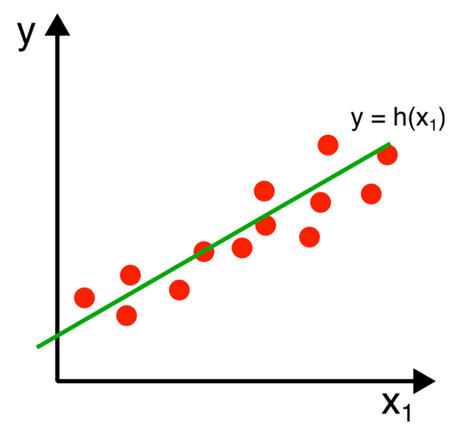

---

### Aprendizaje estadístico

La regresión lineal es parte de una subárea del aprendizaje automático llamada **aprendizaje estadístico**, que:

- Se enfoca en el estudio de modelos estadísticos y métodos para analizar y comprender los datos.
- Utiliza herramientas y técnicas estadísticas clásicas para hacer inferencias y tomar decisiones basadas en los datos.
- Su enfoque principal puede ser la estimación de parámetros, la predicción o la inferencia sobre la relación entre variables.

---

## 📏 Regresión lineal

### El modelo

El modelo de regresión lineal es una combinación lineal de las variables de entrada:

$$\hat{y} = h(X) = b + w_0 x_0 + w_1 x_1 + \cdots + w_{d-1} x_{d-1}$$

- $X = (x_0, x_1, \ldots, x_{d-1})$: son las **características** (*features*) de nuestras observaciones. Son todas variables numéricas, y en total tenemos $d$.
- $b, w_0, \ldots, w_{d-1}$: son los **coeficientes** del modelo. Son números reales. Cuanto más cerca de cero esté un coeficiente, menos depende la variable dependiente del *feature* que multiplica. Al coeficiente $b$ lo llamamos **ordenada al origen**.
- $\hat{y}$: es la **predicción** del modelo. Se compara con la **etiqueta** (*label*) de la observación.

También podemos expresarlo en notación matricial:

$$\hat{y} = h(X) = b + \mathbf{W}^T \mathbf{X}$$

---

### ¿Cuál recta?

Con una sola variable de entrada, el modelo es una recta: $\hat{y} = b + w_0 x_0$, donde $w_0$ es la **pendiente** y $b$ es la **ordenada al origen**.

  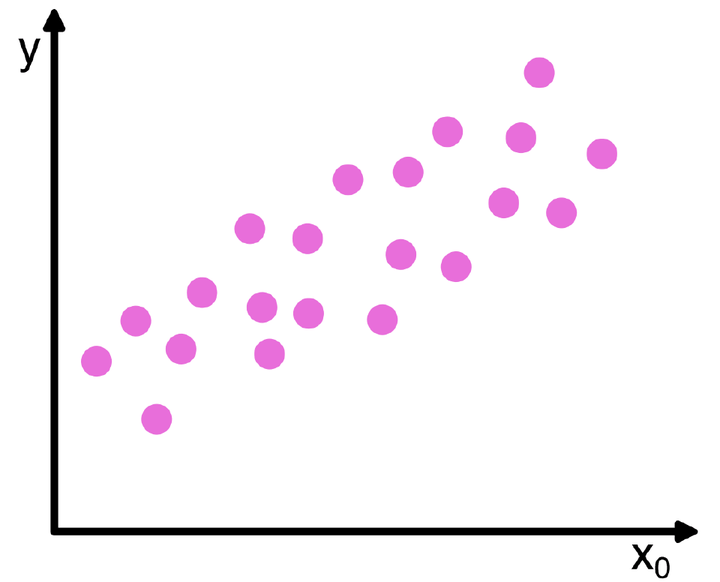
  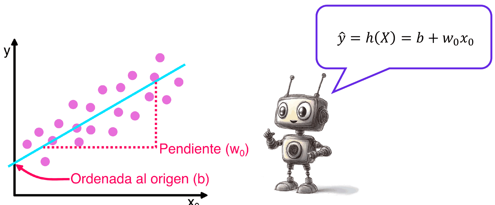

Pero hay infinitas rectas posibles. ¿Cuál elegimos?

  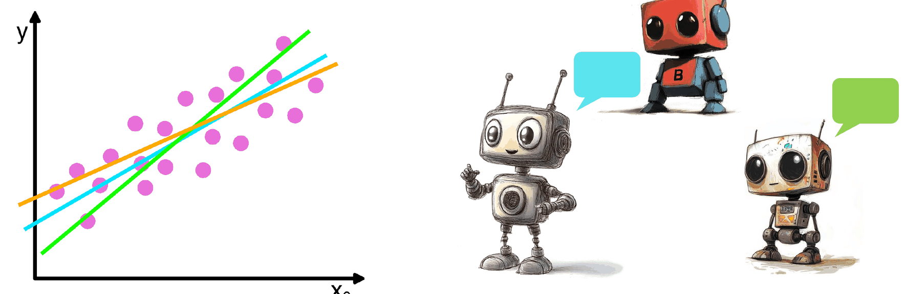

---

### Residuos

Para encontrarla, medimos la distancia vertical entre la recta y cada punto, a lo que llamamos **residuos**:

$$e_{[i]} = y_{[i]} - \hat{y}_{[i]}$$

$$y_{[i]} = \hat{y}_{[i]} + e_{[i]} = b + w_0 x_{0[i]} + e_{[i]}$$

  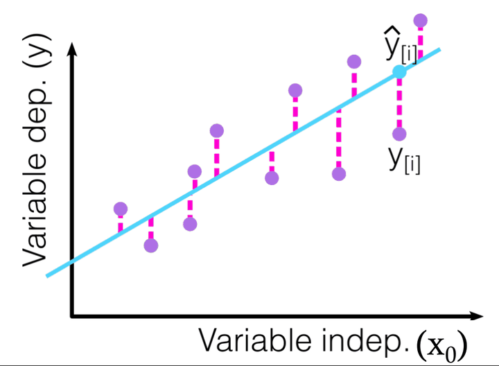

---

### Mínimos cuadrados

Buscamos minimizar el valor de los residuos. Para lograrlo, minimizamos la **suma de los cuadrados de los residuos**:

$$S_{res} = \sum_{i=0}^{N-1} e_{[i]}^2 = \sum_{i=0}^{N-1} \left(y_{[i]} - b - w_0 x_{0[i]}\right)^2$$

$$\min(S_{res}) = \min\left(\sum_{i=0}^{N-1} e_{[i]}^2\right)$$

Para minimizar, solo podemos ajustar los coeficientes. Lo que hacemos es buscar donde el **gradiente** se anula:

$$\frac{\partial S_{res}}{\partial b} = 0 \qquad \frac{\partial S_{res}}{\partial w_0} = 0$$

---

### Ecuaciones normales

En la regresión lineal, $S_{res}$ es siempre una función convexa de los coeficientes, es decir, tiene un solo mínimo.

  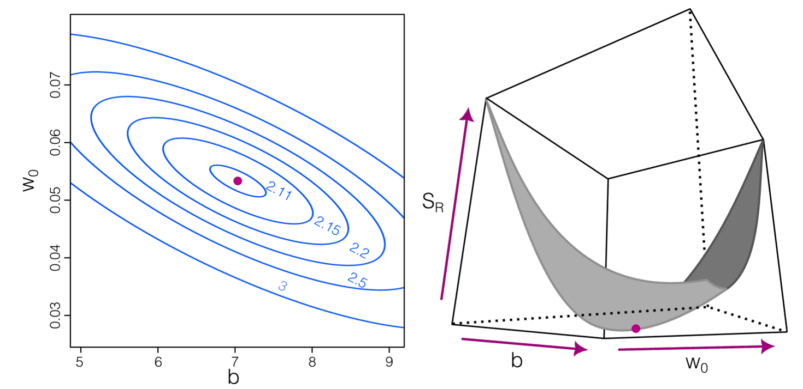

Si desarrollamos las derivadas, obtenemos un sistema de ecuaciones, llamado **ecuaciones normales**. El problema es que, cuando tenemos muchos datos o muchos atributos, resolver el sistema es muy costoso. ¡En esos casos, podemos usar **gradiente descendente**!

Las ecuaciones normales también se pueden obtener maximizando la **verosimilitud**, suponiendo que los residuos tienen una distribución normal. El desarrollo completo está en el siguiente apunte:

- 📘 [Obtención de ecuaciones normales mediante máxima verosimilitud](../ecuaciones_normales_maxima_verosimilitud.md)

---

### ¿Qué tan bien se ajusta?

¿Cómo medimos qué tan bien se ajusta una regresión a nuestros datos? Si medimos la variabilidad total de la variable dependiente en los datos:

$$S_T = \sum_{i=0}^{N-1} \left(y_{[i]} - \bar{y}\right)^2$$

Esta variabilidad se puede separar en dos partes: una parte que es **atribuida al modelo** y otra que **no** (los residuos):

$$S_T = S_{model} + S_{res}$$

$$S_T = \sum_{i=0}^{N-1} \left(\hat{y}_{[i]} - \bar{y}\right)^2 + \sum_{i=0}^{N-1} e_{[i]}^2$$

  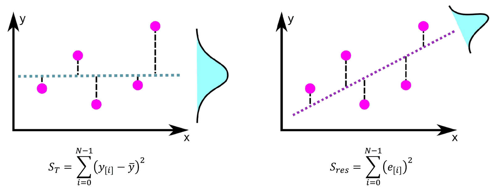

---

### Métricas de ajuste

Como métricas, podemos usar:

- El **desvío estándar residual**, donde $d$ es la cantidad de atributos:

$$s_{res} = \sqrt{\frac{S_{res}}{N - d - 1}} = \sqrt{\frac{1}{N - d - 1} \sum_{i=0}^{N-1} e_{[i]}^2}$$

- El **coeficiente de determinación** ($R^2$), que mide qué proporción de la variabilidad de $y$ explica el modelo:

$$R^2 = \frac{S_{model}}{S_T} = 1 - \frac{S_{res}}{S_T}$$

> [!NOTE]
> En los videos, al $R^2$ lo llamamos **coeficiente de Pearson**. El nombre correcto es **coeficiente de determinación**. El coeficiente de Pearson es la correlación $r$ entre dos variables; en la regresión lineal simple se cumple que $R^2 = r^2$.

---

### El cuarteto de Anscombe

Las métricas no lo dicen todo. Estos cuatro conjuntos de datos, conocidos como el **cuarteto de Anscombe**, tienen la misma recta de regresión y prácticamente el mismo $R^2$, pero son muy distintos entre sí. Por eso, siempre conviene graficar los datos:

  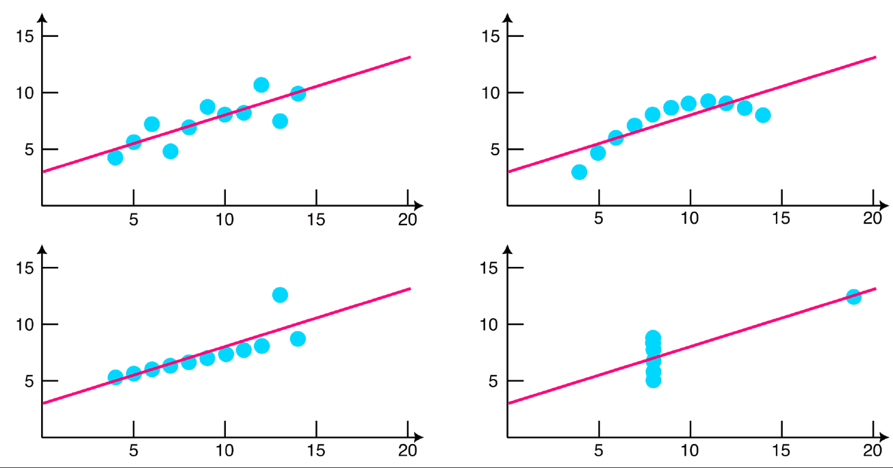

---

### Suposiciones

Las suposiciones que usamos para aplicar la regresión lineal son:

- **Relación lineal**: al aplicar el modelo, muchas veces buscamos validar esta suposición.
- **Features independientes**: los *features* de entrada de la regresión deben ser independientes entre sí.
- **Residuos**: deben provenir de una distribución normal $N(0, \sigma^2)$ y ser independientes entre sí. Que la varianza $\sigma^2$ sea la misma en todo el rango se llama **homocedasticidad**.

  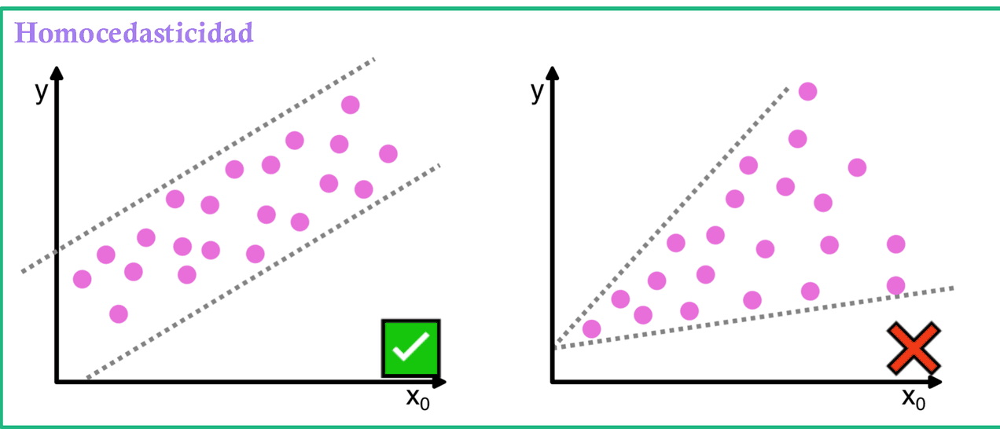

---

## 🔧 Tratamiento de variables

### Normalización o estandarización

En la regresión lineal, tenemos la multiplicación de los coeficientes por nuestras entradas:

$$\hat{y} = b + w_0 x_0 + w_1 x_1$$

Los coeficientes nos dan un **valor de importancia de las entradas**, pero esto es válido solo si todas las entradas están en la misma escala.

Si la variable $x_0$ está en el rango $[1000, 3000]$ y $x_1$ en $[-1, 1]$, los valores de $w_0$ y $w_1$ estarán en escalas diferentes y, por lo tanto, no serán comparables.

---

### Normalización

Una forma de **normalizar** es hacer que los valores estén aproximadamente entre 0 y 1, utilizando el valor máximo y el valor mínimo:

$$\tilde{x} = \frac{x - \min(x)}{\max(x) - \min(x)}$$

Si se necesita normalizar entre -1 y 1:

$$\tilde{x} = 2 \frac{x - \min(x)}{\max(x) - \min(x)} - 1$$

Los valores de $\min(x)$ y $\max(x)$ se calculan con el **set de entrenamiento**.

---

### Estandarización

Otra forma es aplicar la **estandarización**, que es menos sensible a los *outliers*:

$$\tilde{x} = \frac{x - \text{mean}(x)}{\text{std}(x)}$$

Los valores de $\text{mean}(x)$ y $\text{std}(x)$ también se calculan con el **set de entrenamiento**.

---

### Variables categóricas

La regresión lineal utiliza variables numéricas para predecir un valor. ¿Cómo podemos usar **variables categóricas**? Para poder usarlas, debemos transformarlas en *numéricas mediante alguna codificación*.

En el caso de **variables categóricas ordinales**, podemos asociarles un número:

| Calificación | Valor |
| :---: | :---: |
| ★☆☆☆☆ | 1 |
| ★★☆☆☆ | 2 |
| ★★★☆☆ | 3 |
| ★★★★☆ | 4 |
| ★★★★★ | 5 |

Si tenemos **casos nominales**, no podemos asociarles números, ya que, al hacerlo, estableceríamos un orden. Para este tipo de variable existen diferentes codificaciones, y una de ellas es el **one-hot encoding**:

  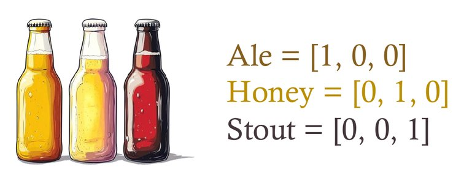

---

### One-hot encoding

Por ejemplo, si tenemos la siguiente tabla:

| Peso | Altura | País |
| :---: | :---: | :---: |
| 80 | 180 | Argentina |
| 83 | 177 | Chile |
| 75 | 169 | Chile |
| 68 | 155 | Argentina |
| 95 | 199 | Perú |

El one-hot encoding genera una columna nueva por cada categoría, y reemplaza a la columna original:

| Peso | Altura | Argentina | Chile | Perú |
| :---: | :---: | :---: | :---: | :---: |
| 80 | 180 | 1 | 0 | 0 |
| 83 | 177 | 0 | 1 | 0 |
| 75 | 169 | 0 | 1 | 0 |
| 68 | 155 | 1 | 0 | 0 |
| 95 | 199 | 0 | 0 | 1 |

---

### La trampa de las variables dummy

El one-hot encoding nos genera un nuevo atributo por categoría, pero esto puede generar *una trampa*. En el ejemplo, las tres variables están 100 % correlacionadas entre sí, ya que $x_{peru} = 1 - x_{arg} - x_{chile}$:

$$\hat{y} = b + w_0 x_{peso} + w_1 x_{altura} + w_2 x_{arg} + w_3 x_{chile} + w_4 x_{peru}$$

$$\hat{y} = b + w_0 x_{peso} + w_1 x_{altura} + w_2 x_{arg} + w_3 x_{chile} + w_4 (1 - x_{arg} - x_{chile})$$

$$\hat{y} = (b + w_4) + w_0 x_{peso} + w_1 x_{altura} + (w_2 - w_4) x_{arg} + (w_3 - w_4) x_{chile}$$

Para solucionar esto, debemos eliminar siempre una columna para romper la trampa. La categoría eliminada queda representada cuando todas las demás valen cero:

| Peso | Altura | Argentina | Chile |
| :---: | :---: | :---: | :---: |
| 80 | 180 | 1 | 0 |
| 83 | 177 | 0 | 1 |
| 75 | 169 | 0 | 1 |
| 68 | 155 | 1 | 0 |
| 95 | 199 | 0 | 0 |

---

## 📊 Métricas de evaluación

### ¿Cómo evaluamos?

*El conjunto de datos de evaluación se utiliza para evaluar qué tan bien se entrenó el algoritmo con el conjunto de datos de entrenamiento.*

¿Pero cómo evaluamos? Podemos usar el **coeficiente de determinación** ($R^2$), o métricas más generales, que midan el error en variables numéricas.

---

### Error absoluto medio (MAE)

El **error absoluto medio** (MAE) es el cálculo del valor absoluto del residuo para cada punto de datos. Luego, tomamos el promedio de todos estos residuos:

$$MAE = \frac{1}{N} \sum_{i=0}^{N-1} \left|y_{[i]} - \hat{y}_{[i]}\right|$$

---

### Error cuadrático medio (MSE)

El **error cuadrático medio** (MSE) es similar al MAE, pero ahora calculamos el cuadrado de los residuos:

$$MSE = \frac{1}{N} \sum_{i=0}^{N-1} \left(y_{[i]} - \hat{y}_{[i]}\right)^2$$

Un detalle importante son los residuos grandes (**outliers**). En esta métrica, su impacto es mayor que en el MAE.

---

### Raíz del error cuadrático medio (RMSE)

Si al MSE le calculamos la raíz cuadrada, obtenemos una métrica llamada **RMSE**, que tiene la misma unidad que la salida original, a diferencia del MSE, que no la tiene:

$$RMSE = \sqrt{\frac{1}{N} \sum_{i=0}^{N-1} \left(y_{[i]} - \hat{y}_{[i]}\right)^2}$$

---

### Outliers

Los valores atípicos son un tema de constante discusión. *¿Se deben incluir o no?*

La respuesta dependerá del problema en particular, de los datos disponibles y de las consecuencias que tenga considerar o no esos valores.

Si quiero tenerlos en cuenta a la hora de comparar modelos, me convendrá usar el **MSE**. En cambio, si quiero reducir su importancia, puedo usar el **MAE**.

---

### Error absoluto porcentual medio (MAPE)

El **error absoluto porcentual medio** (MAPE) es el cálculo del MAE, pero escalado al valor verdadero, por lo que el resultado es porcentual:

$$MAPE = \frac{100\%}{N} \sum_{i=0}^{N-1} \left|\frac{y_{[i]} - \hat{y}_{[i]}}{y_{[i]}}\right|$$

No es una métrica ideal, porque es susceptible a errores numéricos: no puede calcularse cuando $y_{[i]}$ es igual a cero. Además, es asimétrica: penaliza más cuando la predicción sobreestima que cuando subestima, por lo que favorece a los modelos que subestiman:

| Caso | $\hat{y}$ | $y$ | MAPE |
| :--- | :---: | :---: | :---: |
| Subestima | 10 | 20 | 50 % |
| Sobreestima | 20 | 10 | 100 % |

---

## 🧱 Construcción de un modelo

### ¿Cómo elegimos los atributos?

Cuando construimos un modelo de regresión múltiple, ¿cómo elegimos los atributos que formarán parte del modelo?

*Ver la correlación entre variables es un primer paso, pero surge la pregunta: si dos variables están correlacionadas, ¿cuál de las dos descartamos?*

Por lo tanto, existen diferentes métodos para construir un modelo:

- Exhaustivo
- Eliminación hacia atrás
- Selección hacia adelante
- Eliminación bidireccional

---

### Eliminación hacia atrás

- Se comienza con un modelo completo que incluye todas las variables.
- Luego, se eliminan de **forma greedy** las variables de entrada que menos *"aportan"* al modelo, una por vez.
- El proceso continúa hasta que eliminar más variables no mejora significativamente el modelo.
- Este proceso se puede realizar utilizando alguna métrica que nos mida la información que aporta cada variable.

---

### Selección hacia adelante

- Comienza con un modelo *vacío* que solo incluye la ordenada al origen: $\bar{y} = \frac{1}{N} \sum_{i=0}^{N-1} y_{[i]}$.
- Luego, se agregan las variables que más aportan al modelo (usando el criterio de ajuste), una por vez.
- El proceso termina cuando agregar más variables no mejora significativamente el modelo.

---

### Eliminación bidireccional

Es, en esencia, la selección hacia adelante, pero con la posibilidad de eliminar en cada iteración las variables que, con las nuevas incorporaciones, dejaron de aportar al modelo.

---

### ¿Cómo sabemos el aporte de cada atributo?

- **Bondad de ajuste**: se realiza una prueba de hipótesis para determinar si el coeficiente de una entrada en particular es cero. Luego, se evalúa el valor p. Un valor p bajo (< 0,05) indica que se puede rechazar la hipótesis nula, lo que sugiere que cambios en esta variable probablemente generen cambios en la respuesta.
- **Coeficiente de determinación ajustado**: es el $R^2$, pero penalizando la complejidad del modelo, donde $N$ es el número de observaciones y $d$, el número de atributos:

$$R_{adj}^2 = 1 - (1 - R^2) \frac{N - 1}{N - d - 1}$$

---

### Criterios de información: AIC y BIC

**Criterio de Información de Akaike (AIC)**: maneja un equilibrio entre la bondad de ajuste del modelo y su complejidad. En otras palabras, el AIC aborda tanto el riesgo de sobreajuste como el riesgo de subajuste:

$$AIC = 2k - 2\ln(\hat{L})$$

donde $k$ es la cantidad de parámetros del modelo (en la regresión lineal, los $d$ coeficientes más la ordenada al origen) y $\hat{L}$ es la verosimilitud máxima del modelo. El valor de AIC debe ser más bajo para indicar un mejor modelo.

**Criterio de Información Bayesiano (BIC)**: se basa en el principio de la navaja de Occam, que establece que es preferible el modelo más simple que explique los datos. A diferencia del AIC, el BIC penaliza más al modelo por su complejidad:

$$BIC = k\ln(N) - 2\ln(\hat{L})$$

El valor de BIC también debe ser más bajo para indicar un mejor modelo.

Cómo se calculan ambos criterios para el caso de la regresión lineal está desarrollado en el siguiente apunte:

- 📘 [Obtención de AIC y BIC para regresión lineal](../aic_bic_regresion_lineal.md)

---

## 🎛️ Regresión de Ridge y Lasso

### Regularización

Con los métodos de **regularización**, podemos ajustar un modelo que contenga todos los atributos utilizando una técnica que restrinja o regularice las estimaciones de los coeficientes.

Puede que no sea inmediatamente obvio por qué tal restricción debería mejorar el ajuste, pero resulta que **reducir las estimaciones de los coeficientes** puede **disminuir significativamente su varianza**.

Las dos técnicas más conocidas para reducir los coeficientes de regresión hacia cero son la regresión de **Ridge** y la regresión de **Lasso**.

---

### Regresión de Ridge

En la regresión lineal, vimos que se buscaban los coeficientes que minimizaban la suma de los residuos al cuadrado. La **regresión de Ridge** es muy similar, pero los coeficientes se estiman minimizando una cantidad diferente:

$$\sum_{i=0}^{N-1} \left(y_{[i]} - b - \mathbf{W}^T \mathbf{X}_{[i]}\right)^2 + \alpha \sum_{j=0}^{d-1} w_j^2$$

donde $\alpha$ es un hiperparámetro de ajuste.

El primer término es $S_{res}$. El segundo término:

$$\alpha \sum_{j=0}^{d-1} w_j^2$$

se conoce como el término de **penalización por encogimiento**. Este término es pequeño cuando los coeficientes están cerca de cero.

---

### El efecto de α

Nótese que la penalización **no afecta a la ordenada al origen $b$**. Si $\alpha$ tiende a $\infty$, todos los coeficientes se vuelven cero, y la regresión queda de la siguiente forma:

$$\hat{y} = b = \frac{1}{N} \sum_{i=0}^{N-1} y_{[i]}$$

  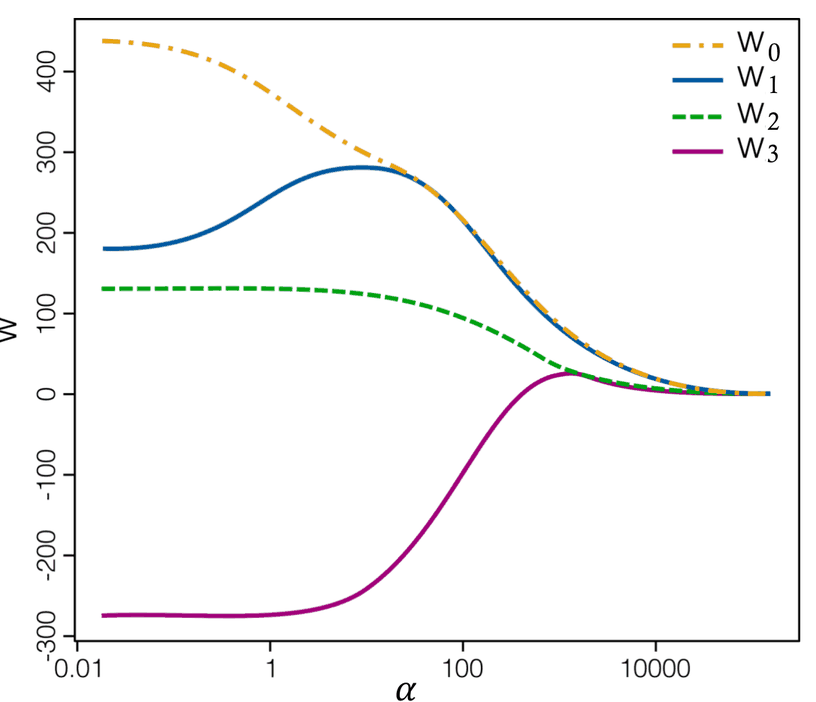

---

### ¿Para qué nos sirve Ridge?

La ventaja de la regresión de Ridge sobre la regresión lineal de mínimos cuadrados radica en el equilibrio entre sesgo y varianza. A medida que $\alpha$ aumenta, la **flexibilidad del ajuste disminuye**, lo que lleva a una **menor varianza**, pero a un **mayor sesgo**.

  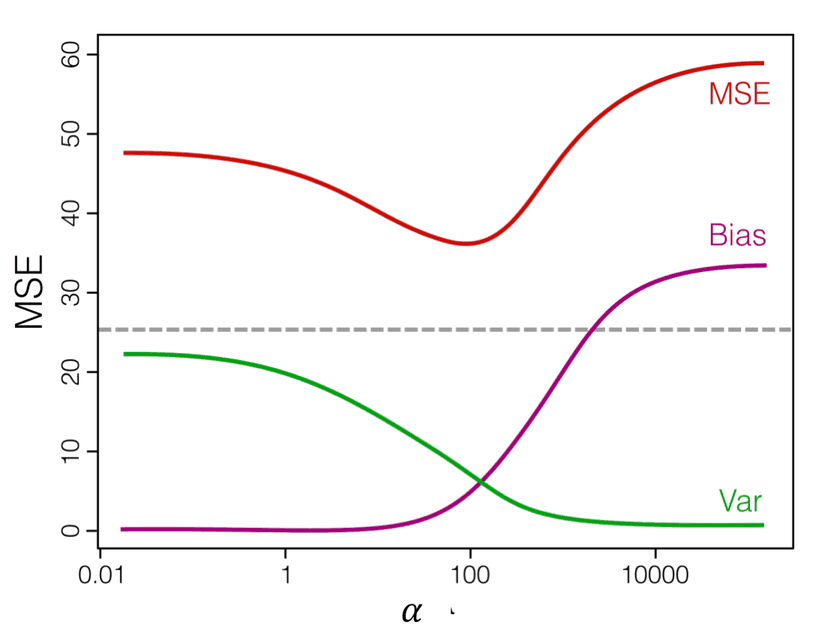

En general, cuando **la verdadera relación es lineal, la regresión lineal tiende a tener mucha varianza**. Esto ocurre principalmente cuando el *número de observaciones es cercano al número de coeficientes*.

  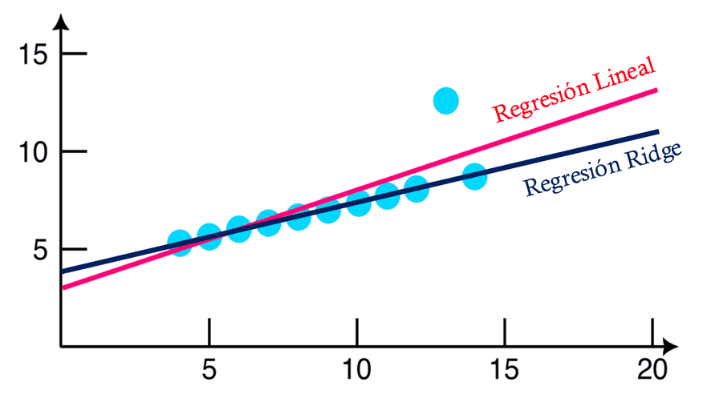

---

### Regresión de Lasso

La regresión de Ridge, a priori, nos parece interesante para hacer una selección de modelo, ya que, al ajustar $\alpha$, **podemos ver si algún coeficiente se acerca a cero**.

El problema es que los coeficientes se reducen hacia cero, pero no se hacen exactamente cero, a menos que $\alpha$ sea infinito. Por lo tanto, **no podemos eliminar atributos**.

La regresión de Lasso cubre esta desventaja:

$$\sum_{i=0}^{N-1} \left(y_{[i]} - b - \mathbf{W}^T \mathbf{X}_{[i]}\right)^2 + \alpha \sum_{j=0}^{d-1} |w_j|$$

La regresión de Lasso utiliza una **penalización L1**, mientras que Ridge utiliza una **penalización L2**.

Cuando $\alpha$ crece, algunos coeficientes se convierten exactamente en cero. *Por lo tanto, Lasso realiza una selección de atributos.*

  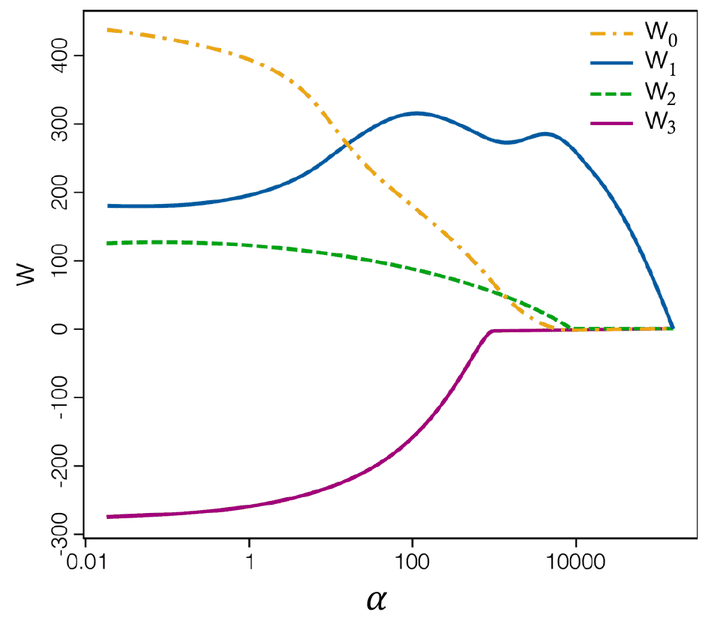

---

### ¿Por qué Lasso anula coeficientes?

Para entender por qué ocurre esto, debemos reescribir las regresiones de una forma equivalente:

**Regresión Lasso**:

$$\min \left\{\sum_{i=0}^{N-1} \left(y_{[i]} - b - \mathbf{W}^T \mathbf{X}_{[i]}\right)^2\right\} \quad \text{sujeto a} \quad \sum_{j=0}^{d-1} |w_j| \le s$$

**Regresión Ridge**:

$$\min \left\{\sum_{i=0}^{N-1} \left(y_{[i]} - b - \mathbf{W}^T \mathbf{X}_{[i]}\right)^2\right\} \quad \text{sujeto a} \quad \sum_{j=0}^{d-1} w_j^2 \le s$$

Veamos el efecto de la penalización en un caso con 2 atributos ($d = 2$). La restricción de Lasso es un rombo ($|w_0| + |w_1| \le s$) y la de Ridge, un círculo ($w_0^2 + w_1^2 \le s$):

  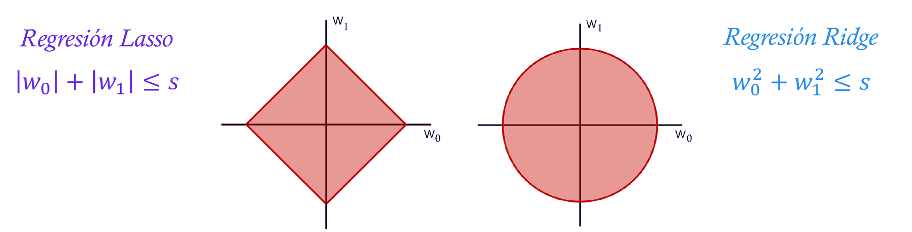

La solución es el primer punto donde las curvas de nivel de $S_{res}$, centradas en la solución de la regresión lineal, tocan la región permitida. Como el rombo tiene vértices sobre los ejes, es muy probable que ese punto esté en un vértice, donde uno de los coeficientes vale exactamente cero. Con el círculo, eso casi nunca ocurre:

  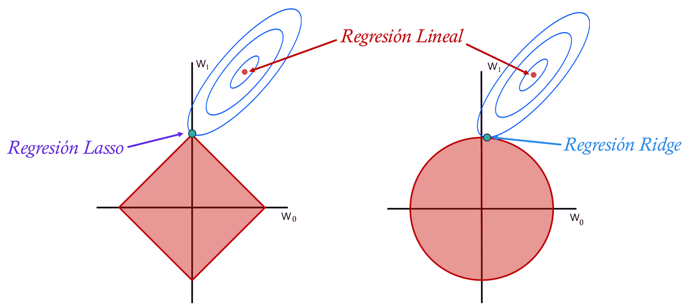

